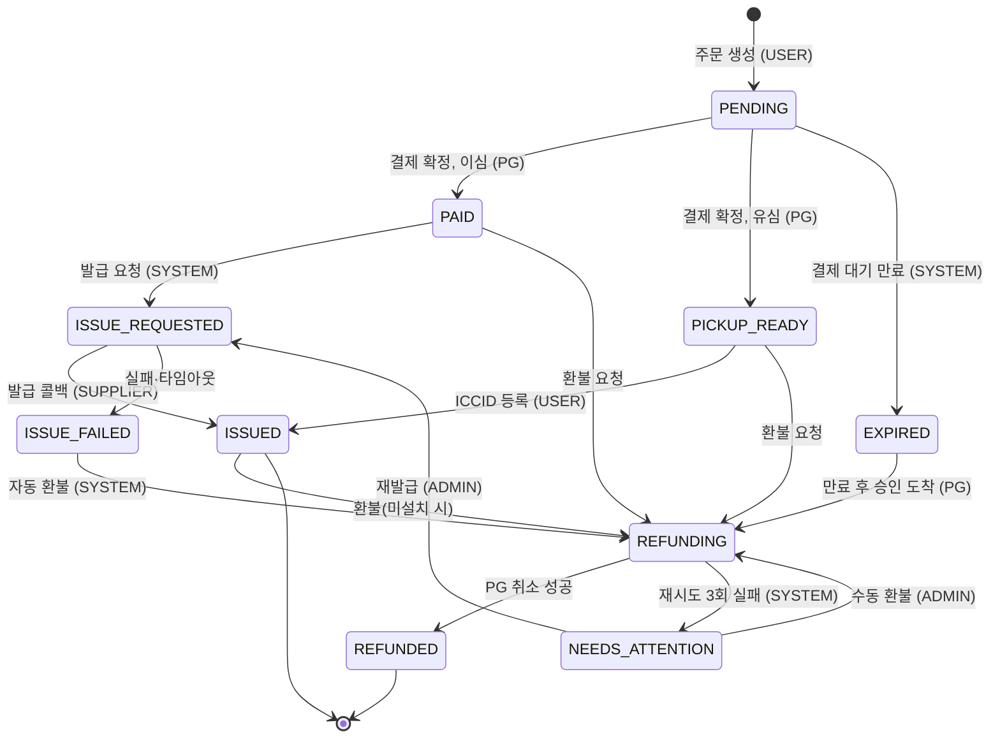
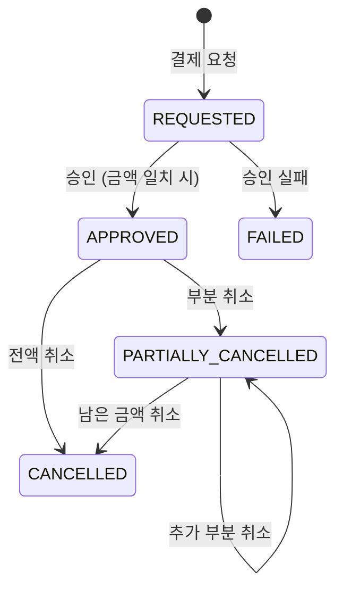
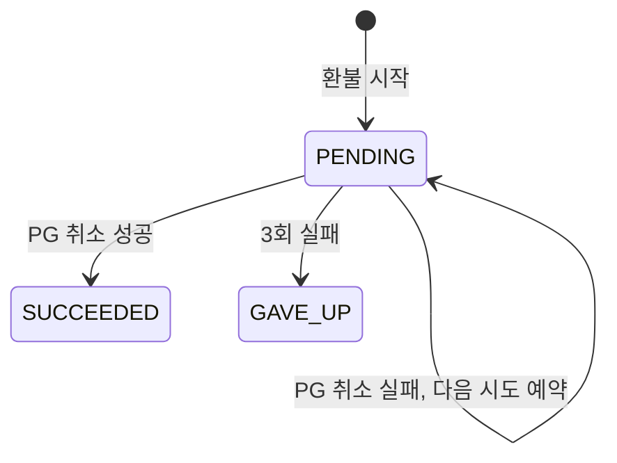
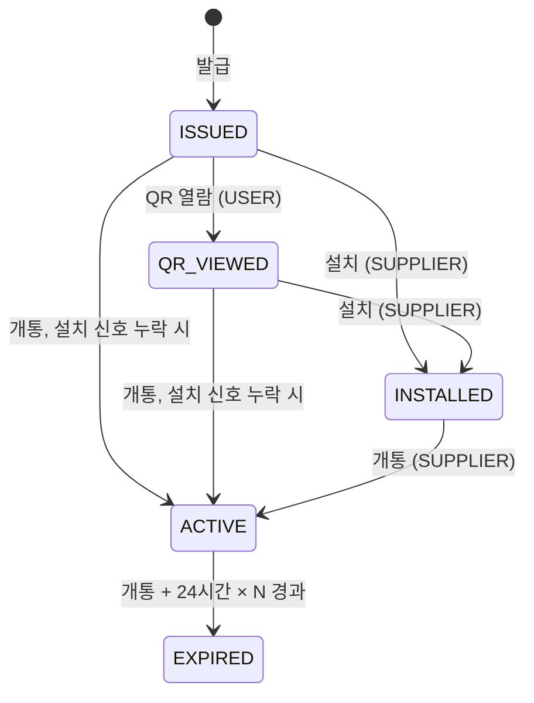

# ROAMPASS_SERVER

여행자용 유심(USIM)·이심(eSIM) 판매 서비스 **ROAMPASS**의 서버

---

## 1. 실행 방법

### 사전 요구사항
- JDK 21
- Docker (로컬 PostgreSQL과 통합 테스트용 Testcontainers에 필요)

### 로컬 실행
```bash
git clone https://github.com/Voyager003/ROAMPASS_SERVER.git
cd ROAMPASS_SERVER

# 1) 로컬 접속 정보 파일 만들기 (둘 다 gitignore 대상, 두 파일의 값은 서로 같아야 함)
cp .env.example .env
cp roampass-api/src/main/resources/application-local.yml.example \
   roampass-api/src/main/resources/application-local.yml

# 2) 로컬 PostgreSQL 기동 (localhost:5432)
docker compose up -d

# 3) 세 앱 실행 (각각 다른 터미널에서)
./gradlew :roampass-api:bootRun     # http://localhost:8080
./gradlew :mock-pg:bootRun          # http://localhost:8081
./gradlew :mock-supplier:bootRun    # http://localhost:8082

# 4) 기동 확인
curl http://localhost:8080/actuator/health
curl http://localhost:8081/actuator/health
curl http://localhost:8082/actuator/health
```
DB 스키마와 시드 데이터는 `roampass-api` 기동 시 Flyway가 자동으로 적용합니다.

### 테스트
```bash
./gradlew test
```
- Docker가 실행 중이어야 합니다. `roampass-api` 통합 테스트는 Testcontainers로 PostgreSQL 17 컨테이너를 직접 띄우므로 `docker compose`나 `application-local.yml`은 필요 없습니다.

### API 호출 시 식별 헤더
회원 시스템 대신 헤더로 호출자를 구분합니다(과제 2.2 허용 범위).
- 사용자 API(`/api/**`): `X-User-Id: user-1`
- 어드민 API(`/admin/**`): `X-Admin-Id: admin-1`

---

## 2. 질문에 대한 답

### 2.1 기술선택 이유

> 진행 중인 초안입니다. 프론트(Next.js)와 배포 호스팅 항목은 해당 작업을 마친 뒤 채웁니다. 결정 전체와 시점은 `docs/decisions.md`에 있습니다.

| 영역 | 선택 | 이유 | 고려했다가 버린 것 |
|---|---|---|---|
| 백엔드 | Java 21, Spring Boot 4.1.1, Gradle | 과제가 지정한 Spring. Initializr 생성본을 그대로 사용 | — |
| DB | PostgreSQL + Flyway(`ddl-auto: validate`) | 유니크 제약·`timestamptz`를 그대로 활용. 빈 DB에서 스키마·시드가 재현되어야 해서 마이그레이션 파일로 관리 | Hibernate `ddl-auto: update` |
| ORM | Spring Data JPA, 단 **도메인 모델과 JPA 엔티티를 분리** | 상태 전이·멱등 규칙을 Spring·DB 없이 단위 테스트하기 위함. JPA 매핑은 도메인이 확정된 뒤 각 단계의 마지막에 작성 | 도메인 객체에 JPA 애너테이션 직접 사용 (대가: 매퍼 코드 증가) |
| 비동기 작업 | DB 상태 기반 `@Scheduled` 폴링 | 결제 커밋 후 사용자가 브라우저를 닫아도 서버가 발급을 끝까지 진행. 외부 인프라가 없고 서버 재시작에도 작업이 사라지지 않음 | 커밋 후 이벤트 + `@Async`, 메시지 큐 (대가: 폴링 주기만큼 지연) |
| 모의 PG · 공급사 | 별도 Spring Boot 앱 2개 (Gradle 멀티모듈), 우리 서버와 **HTTP로만** 통신 | PG 타임아웃·공급사 다운·콜백 누락을 실제 프로세스·네트워크 분리로 재현. 서명(HMAC) 코드도 모듈마다 따로 구현해 "계약만 공유"함을 보임 | 같은 앱 안의 컨트롤러 |
| 테스트 | JUnit 5 + AssertJ, Testcontainers PostgreSQL | 중복 처리의 핵심인 유니크 제약·조건부 UPDATE는 실제 PostgreSQL에서만 검증 의미가 있음 | H2 (PostgreSQL 모드) |
| 인증 | `X-User-Id` / `X-Admin-Id` 헤더 | 과제가 헤더 수준이면 충분하고 평가 항목이 아니라고 명시. 헤더는 위조 가능하다는 한계를 인지 | 회원 도메인 + 로그인 |
| 에러 응답 | RFC 9457 `ProblemDetail` + `code` | Spring 내장 표준 형식. 도메인 예외는 HTTP를 모르고, 웹 계층에서 상태 코드로 매핑 | 자체 응답 형식 |
| 금액 | `Money` 값 객체 (금액 + 통화, 음수 금지) | 부분 취소 시 "승인 금액보다 많이 취소"를 값 수준에서 차단. 다통화 확장 대비 | `long` 금액만 사용 |
| 프론트 | _(작성 예정)_ | | |
| 배포 | _(작성 예정)_ Oracle Cloud Always Free 인스턴스 2대 예정 | | |

### 2.2 결제, 발급, 주문 상태 설계

> 상태와 전이 규칙은 도메인 모델(순수 Java)로 구현되어 단위 테스트로 고정되어 있습니다. 상태를 바꾸는 주체(스케줄러·콜백·API)는 이후 단계에서 연결하며, 아직 구현 전인 부분은 _(구현 예정)_ 으로 표시했습니다.

**원칙: 주문 상태와 SIM 상태를 나눴습니다.**
- **주문(`Order`)**: 돈을 받고 SIM을 내주기까지(결제 → 발급 → 환불). 이심이든 유심이든 SIM을 내주면 `ISSUED`로 끝납니다.
- **SIM(`SimProfile`)**: 내준 SIM이 기기에서 어떻게 되는지(QR 열람 → 설치 → 개통 → 만료).

두 흐름은 신호를 주는 곳이 다릅니다. 주문은 PG와 공급사의 발급 결과로 바뀌고, SIM은 공급사의 상태 조회·개통 이벤트로 바뀝니다. 바뀌는 주기도 다르기 때문에 하나의 상태로 섞지 않았습니다.

#### 주문 상태
| 상태 | 뜻 |
|---|---|
| `PENDING` | 주문 생성, 결제 대기 (기본 10분 뒤 만료) |
| `EXPIRED` | 결제 대기 시간 초과 |
| `PAID` | 결제 확정, 이심 발급 요청 대기 |
| `PICKUP_READY` | 결제 확정, 유심 공항 수령 대기 |
| `ISSUE_REQUESTED` | 공급사에 발급 요청, 콜백 대기 |
| `ISSUED` | SIM을 내줌 (이심: 콜백으로 ICCID·활성화 코드 수신 / 유심: ICCID 등록) |
| `ISSUE_FAILED` | 발급 최종 실패 — 돈은 받은 상태 |
| `REFUNDING` | 환불 진행 중 (PG 취소 재시도 포함) |
| `REFUNDED` | 환불 완료 (종료) |
| `NEEDS_ATTENTION` | 자동 처리 포기, 운영자 확인 대상 |



전이 규칙은 `OrderStatus` 한 곳에 표로 정의되어 있고, 표에 없는 전이는 `IllegalStateTransitionException`으로 거부됩니다.

**설계에서 고민한 지점**
- **만료 직전 결제, 만료 뒤 승인 도착**: 만료된 주문은 되살리지 않고 `EXPIRED → REFUNDING`으로 돈을 돌려줍니다. 만료 판정은 승인이 도착한 시각과 만료 시각을 비교하므로, 만료 스케줄러가 언제 돌았는지와 관계없이 결과가 같습니다.
- **스케줄러가 돌기 전의 만료**: 만료 시각이 지난 `PENDING` 주문은 조회와 결제 요청에서 이미 `EXPIRED`로 취급합니다. 스케줄러 주기만큼 생기는 공백이 없습니다.
- **결제 실패 후 재시도**: 승인이 실패해도 주문은 `PENDING`으로 남고, 만료 전까지 다시 결제할 수 있습니다. 결제는 시도마다 1건이고, 주문당 승인된 결제는 최대 1건입니다.
- **환불을 별도 상태로**: PG 취소는 타임아웃·5xx로 실패할 수 있습니다. 재시도하는 동안 주문이 `ISSUED`나 `ISSUE_FAILED`로 보이면 잘못 읽히므로 `REFUNDING`을 두었습니다. 재시도는 최대 3회(1분 → 2분 → 4분)이고, 넘으면 `NEEDS_ATTENTION`으로 운영자에게 넘깁니다.
- **재발급 제한**: 운영자 재발급은 한 번도 발급된 적 없는 이심 주문만 가능합니다. 한 주문에 프로필이 두 번 붙지 않게 하기 위해서입니다.
- **설치된 SIM은 환불 불가**: `ISSUED`의 환불은 SIM이 한 번도 설치·개통되지 않았을 때만 허용합니다. 판정은 `SimProfile`이 합니다.

**결제는 됐는데 발급이 안 된 주문은 어디에 있고, 누가 끝내는가**

| 있는 곳 | 끝내는 주체 |
|---|---|
| `PAID` (발급 요청 전) | 발급 스케줄러가 집어 가서 `ISSUE_REQUESTED`로 _(구현 예정)_ |
| `ISSUE_REQUESTED` (콜백 대기) | 공급사 콜백이 `ISSUED`로. 콜백이 정해진 시간 안에 오지 않으면 스케줄러가 `ISSUE_FAILED`로 _(구현 예정)_ |
| `ISSUE_FAILED` | 스케줄러가 자동 환불 시작 → `REFUNDING` _(구현 예정)_ |
| `REFUNDING` | 환불 스케줄러가 PG 취소를 재시도해 `REFUNDED`로. 3회 실패하면 `NEEDS_ATTENTION` _(구현 예정)_ |
| `NEEDS_ATTENTION` | 운영자가 수동 환불 또는 재발급. 사유가 반드시 이력에 남음 |

어느 경우에도 "결제됐는데 아무 흔적 없이 멈춘 주문"이 남지 않도록, 모든 중간 상태에 그 상태를 끝낼 주체를 정해 두었습니다.

**사용자가 결제 직후 브라우저를 닫으면**: 결제 확정 뒤의 발급은 클라이언트가 이어서 호출하지 않고, 서버 스케줄러가 `PAID` 주문을 집어 진행합니다 _(구현 예정)_. 그래서 브라우저를 닫아도 발급은 끝까지 진행됩니다. 사용자는 나중에 "내 SIM"에서 결과를 확인합니다.

#### 결제 상태 (결제 시도 1건)

- 같은 승인(같은 PG 거래 ID)이 다시 오면 아무것도 바꾸지 않습니다. 승인 응답과 웹훅이 둘 다 오거나 웹훅이 여러 번 와도 한 번만 반영됩니다.
- 통지 금액이 결제 금액과 다르면 승인하지 않습니다(결제는 `REQUESTED`로 남음).
- `APPROVED`와 `FAILED`는 서로 뒤집히지 않습니다. 취소 누적액은 승인 금액을 넘을 수 없습니다.
- PG 응답이 유실되면 `REQUESTED`로 남겨 두고, PG 상태 조회나 웹훅으로 확정합니다 _(구현 예정)_.

#### 환불 요청 상태

운영자가 `GAVE_UP` 뒤에 수동 환불을 하면 새 환불 요청을 만듭니다. 그래서 "자동 3회 실패 → 운영자 수동 환불" 기록이 구분되어 남습니다.

#### SIM 설치 상태

- 앞으로만 진행합니다. 늦게 도착한 이전 단계 신호와 중복 신호는 예외 없이 무시합니다. 신호 순서가 바뀌는 것은 정상 상황이기 때문입니다.
- 만료는 **개통 시각 + 24시간 × 사용 일수**입니다. 예: `2026-05-01T15:20:00Z`에 개통한 7일 요금제는 `2026-05-08T15:20:00Z`, 즉 **한국 시간 5월 9일 00:20**에 만료됩니다.
- 기기에서 프로필을 지워도 상태는 그대로 두고 삭제 시각만 기록합니다. 설치했다 지운 SIM은 여전히 환불할 수 없습니다.

### 2.3 중복 처리를 어떻게 막았고, 어떻게 증명했습니까?

### 2.4 트랜잭션 경계

### 2.5 "이 사용자가 SIM을 설치했다"를 무엇으로 판단

### 2.6 어드민과 사용자 화면에서 서버와 클라이언트의 경계

### 2.7 이번 과제에서 처음 써본 것

### 2.8 시간이 더 있었다면?

---

## 시연 방법

_(모의 PG·공급사의 실패·지연·중복을 켜는 방법, 설치·개통을 흉내 내는 방법)_

---

## 배포

_(배포한 곳과 고른 이유, 콜백 주소를 잡은 방법, 배포하며 막혔던 지점)_

---

## 아키텍처 · 데이터 모델

| 모듈 | 역할 | 배포 위치 |
|---|---|---|
| `roampass-api` | 주문·결제 확정·발급 오케스트레이션·어드민·설치 추적 | 인스턴스 A (+ PostgreSQL) |
| `mock-pg` | 모의 PG (승인·취소·웹훅·장애 주입) | 인스턴스 B |
| `mock-supplier` | 모의 공급사 (발급·콜백·상태 조회·유심 개통·장애 주입) | 인스턴스 B |

### roampass-api 구조
도메인별 패키지 안에 계층을 둡니다. 의존은 항상 도메인 쪽(안쪽)으로만 향합니다.
```
com.roampass_server
├── common/
│   ├── domain/   # 순수 Java 공유 커널: 도메인 예외, UserId·AdminId, Money, KoreaTime
│   ├── web/      # 에러 응답(ProblemDetail), 식별 헤더 처리
│   └── config/   # Clock 빈
└── {도메인}/      # plan, order, payment, issuance, admin, history (단계별로 추가)
    ├── api/             # 컨트롤러, 요청·응답 DTO
    ├── application/     # 유스케이스, 트랜잭션 경계
    ├── domain/          # 순수 Java 모델 · 리포지토리 인터페이스
    └── infrastructure/  # JPA 엔티티·어댑터, 외부 HTTP 클라이언트, 스케줄러
```

### 도메인 모델
모든 집합 루트와 값 객체는 Spring·JPA를 모르는 순수 Java이고, 상태 전이와 불변식은 단위 테스트로 고정되어 있습니다. 집합 루트끼리는 객체가 아니라 식별자(주문번호 등)로만 참조합니다.

| 집합 루트 | 패키지 | 주요 값 객체 | 책임 |
|---|---|---|---|
| `Plan` | `plan` | `PlanSpec`(국가·일수·데이터 용량) | 판매 중인 요금제 |
| `Order` | `order` | `PlanSnapshot`, `OrderStatus` | 주문 상태 전이, 결제 대기 만료, 여행 시작일 검증 |
| `Payment` | `payment` | `IdempotencyKey`, `PgTid`, `PaymentStatus` | 승인 멱등, 금액 검증, 누적 취소 |
| `RefundAttempt` | `payment` | `RetryPolicy`, `RefundStatus` | 환불 재시도 상한·지수 백오프 |
| `SimProfile` | `issuance` | `Iccid`(Luhn), `ActivationCode`, `SupplierOrderNo`, `UsagePeriod`, `InstallStatus` | 설치 상태(앞으로만), KST 만료일, 환불 가능 판정 |
| `StatusHistory` | `history` | `HistoryTarget` | 추가만 가능한 상태 변경 기록, 운영자 사유 필수 |

여러 도메인이 함께 쓰는 값은 `common.domain`에 둡니다: `Money`, `OrderNo`, `SimType`, `UserId`·`AdminId`, `Actor`, `KoreaTime`.

- 데이터 용량은 요금제 전체 기간의 총량(MB)으로 가정했습니다. 과제에는 하루 기준인지 총량인지 나와 있지 않습니다.

_(ERD는 영속성 계층을 만드는 단계에서 추가)_

---

## 미구현 · 타협한 부분과 이유

