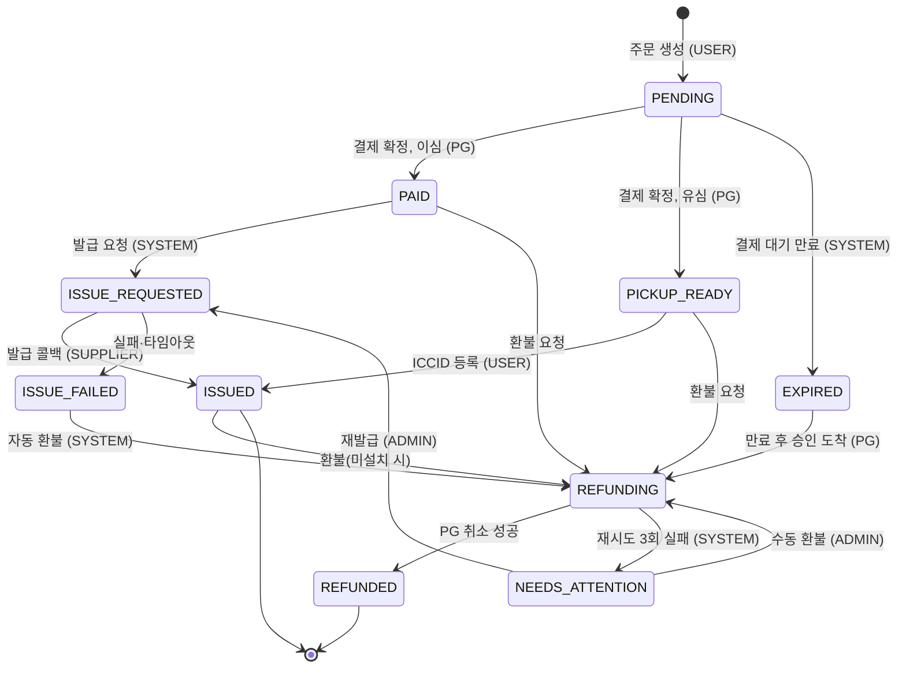
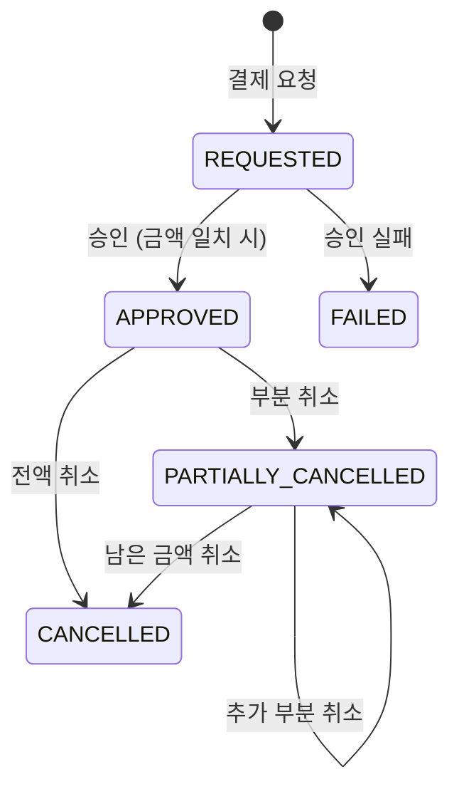
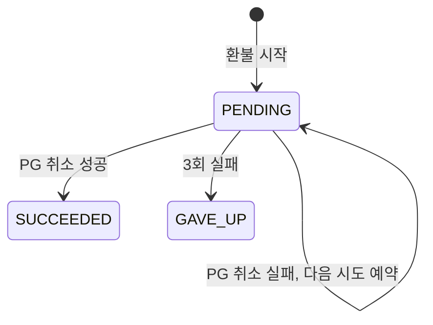
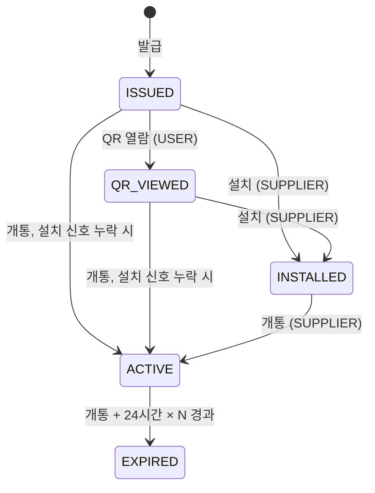
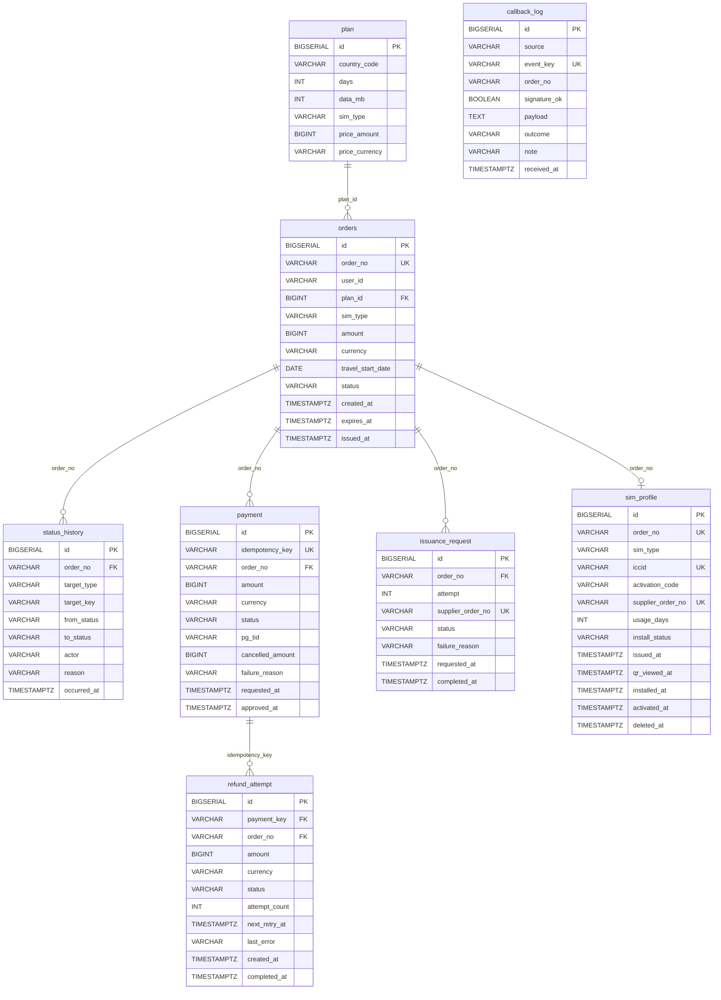

# ROAMPASS_SERVER

여행자용 유심(USIM)·이심(eSIM) 판매 서비스 **ROAMPASS**의 서버

---

## 1. 실행 방법

### 사전 요구사항
- JDK 21
- Docker (로컬 PostgreSQL과 통합 테스트용 Testcontainers에 필요)

### 로컬 실행
```bash
git clone https://github.com/Voyager003/ROAMPASS_SERVER.git
cd ROAMPASS_SERVER

# 1) 로컬 접속 정보 파일 만들기 (둘 다 gitignore 대상, 두 파일의 값은 서로 같아야 함)
cp .env.example .env
cp roampass-api/src/main/resources/application-local.yml.example \
   roampass-api/src/main/resources/application-local.yml

# 2) 로컬 PostgreSQL 기동 (localhost:5432)
docker compose up -d

# 3) 세 앱 실행 (각각 다른 터미널에서)
./gradlew :roampass-api:bootRun     # http://localhost:8080
./gradlew :mock-pg:bootRun          # http://localhost:8081
./gradlew :mock-supplier:bootRun    # http://localhost:8082

# 4) 기동 확인
curl http://localhost:8080/actuator/health
curl http://localhost:8081/actuator/health
curl http://localhost:8082/actuator/health
```
DB 스키마와 시드 데이터는 `roampass-api` 기동 시 Flyway가 자동으로 적용합니다.

### 테스트
```bash
./gradlew test
```
- Docker가 실행 중이어야 합니다. `roampass-api` 통합 테스트는 Testcontainers로 PostgreSQL 17 컨테이너를 직접 띄우므로 `docker compose`나 `application-local.yml`은 필요 없습니다.

### API 호출 시 식별 헤더
회원 시스템 대신 헤더로 호출자를 구분합니다(과제 2.2 허용 범위).
- 사용자 API(`/api/**`): `X-User-Id: user-1`
- 어드민 API(`/admin/**`): `X-Admin-Id: admin-1`

```bash
# 요금제 목록 (헤더 불필요, 조건은 모두 선택·정확히 일치)
curl 'localhost:8080/api/plans?country=JP&simType=ESIM'

# 주문 생성 → 201 + Location, 10분 안에 결제하지 않으면 EXPIRED
curl -i -X POST localhost:8080/api/orders -H 'X-User-Id: user-1' \
  -H 'Content-Type: application/json' -d '{"planId": 1, "travelStartDate": "2026-10-25"}'

# 주문 조회 (남의 주문은 404)
curl localhost:8080/api/orders/{orderNo} -H 'X-User-Id: user-1'

# 결제 (mock-pg가 떠 있어야 함) → paymentStatus·orderStatus
curl -X POST localhost:8080/api/orders/{orderNo}/pay -H 'X-User-Id: user-1'

# 내 SIM 목록 (결제된 주문만, 최신순, size 최대 50)
curl 'localhost:8080/api/sims?page=0&size=20' -H 'X-User-Id: user-1'

# 내 SIM 상세: 결제 금액·주문/설치 상태·ICCID·활성화 코드·만료 시각·남은 시간·환불 가능 여부·발급 대기 정보
curl localhost:8080/api/sims/{orderNo} -H 'X-User-Id: user-1'

# 사용자 환불 요청 → 202 REFUNDING (발급 전이거나 설치 전 SIM만, 아니면 409)
curl -X POST localhost:8080/api/orders/{orderNo}/refund -H 'X-User-Id: user-1'
```
- 응답 시각은 UTC ISO-8601(`...Z`)입니다. 에러는 RFC 9457 `ProblemDetail`에 `code`(예: `ORDER_NOT_FOUND`, `INVALID_REQUEST`)가 붙습니다.
- `travelStartDate`는 KST 기준 오늘부터 1년 이내여야 합니다.
- 브라우저에서 직접 호출할 때는 `roampass.cors.allowed-origins`(기본 `http://localhost:3000`, 환경변수 `CORS_ALLOWED_ORIGINS`)에 있는 주소만 허용합니다. 제출용 프론트(Next.js)는 서버 컴포넌트·Server Action에서만 이 API를 부르는 BFF 구조라 CORS를 거치지 않고, 이 설정은 브라우저나 다른 클라이언트가 직접 부를 때를 위한 것입니다.

---

## 2. 질문에 대한 답

### 2.1 기술선택 이유

> 진행 중인 초안입니다. 프론트(Next.js)와 배포 호스팅 항목은 해당 작업을 마친 뒤 채웁니다. 결정 전체와 시점은 `docs/decisions.md`에 있습니다.

| 영역 | 선택 | 이유 | 고려했다가 버린 것 |
|---|---|---|---|
| 백엔드 | Java 21, Spring Boot 4.1.1, Gradle | 과제가 지정한 Spring. Initializr 생성본을 그대로 사용 | — |
| DB | PostgreSQL + Flyway(`ddl-auto: validate`) | 유니크 제약·`timestamptz`를 그대로 활용. 빈 DB에서 스키마·시드가 재현되어야 해서 마이그레이션 파일로 관리 | Hibernate `ddl-auto: update` |
| ORM | Spring Data JPA, 단 **도메인 모델과 JPA 엔티티를 분리** | 상태 전이·멱등 규칙을 Spring·DB 없이 단위 테스트하기 위함. JPA 매핑은 도메인이 확정된 뒤 각 단계의 마지막에 작성 | 도메인 객체에 JPA 애너테이션 직접 사용 (대가: 매퍼 코드 증가) |
| 비동기 작업 | DB 상태 기반 `@Scheduled` 폴링 | 결제 커밋 후 사용자가 브라우저를 닫아도 서버가 발급을 끝까지 진행. 외부 인프라가 없고 서버 재시작에도 작업이 사라지지 않음 | 커밋 후 이벤트 + `@Async`, 메시지 큐 (대가: 폴링 주기만큼 지연) |
| 모의 PG · 공급사 | 별도 Spring Boot 앱 2개 (Gradle 멀티모듈), 우리 서버와 **HTTP로만** 통신 | PG 타임아웃·공급사 다운·콜백 누락을 실제 프로세스·네트워크 분리로 재현. 서명(HMAC) 코드도 모듈마다 따로 구현해 "계약만 공유"함을 보임 | 같은 앱 안의 컨트롤러 |
| 테스트 | JUnit 5 + AssertJ, Testcontainers PostgreSQL | 중복 처리의 핵심인 유니크 제약·조건부 UPDATE는 실제 PostgreSQL에서만 검증 의미가 있음 | H2 (PostgreSQL 모드) |
| 인증 | `X-User-Id` / `X-Admin-Id` 헤더 | 과제가 헤더 수준이면 충분하고 평가 항목이 아니라고 명시. 헤더는 위조 가능하다는 한계를 인지 | 회원 도메인 + 로그인 |
| 에러 응답 | RFC 9457 `ProblemDetail` + `code` | Spring 내장 표준 형식. 도메인 예외는 HTTP를 모르고, 웹 계층에서 상태 코드로 매핑 | 자체 응답 형식 |
| 금액 | `Money` 값 객체 (금액 + 통화, 음수 금지) | 부분 취소 시 "승인 금액보다 많이 취소"를 값 수준에서 차단. 다통화 확장 대비 | `long` 금액만 사용 |
| 프론트 | _(작성 예정)_ | | |
| 배포 | _(작성 예정)_ Oracle Cloud Always Free 인스턴스 2대 예정 | | |

### 2.2 결제, 발급, 주문 상태 설계

> 상태와 전이 규칙은 도메인 모델(순수 Java)로 구현되어 단위 테스트로 고정되어 있습니다. 상태를 바꾸는 주체(스케줄러·콜백·API) 중 주문 생성(API), 결제 대기 만료(스케줄러), 결제 확정(승인 응답·PG 웹훅·상태 조회 스케줄러), 이심 발급(발급 스케줄러·공급사 콜백·대기 초과 스케줄러), 자동 환불(환불 스케줄러), 유심 ICCID 등록(API), 설치 추적(공급사 상태 폴링), 운영자 조치(어드민 API)까지 모두 연결되어 있습니다.

**원칙: 주문 상태와 SIM 상태를 나눴습니다.**
- **주문(`Order`)**: 돈을 받고 SIM을 내주기까지(결제 → 발급 → 환불). 이심이든 유심이든 SIM을 내주면 `ISSUED`로 끝납니다.
- **SIM(`SimProfile`)**: 내준 SIM이 기기에서 어떻게 되는지(QR 열람 → 설치 → 개통 → 만료).

두 흐름은 신호를 주는 곳이 다릅니다. 주문은 PG와 공급사의 발급 결과로 바뀌고, SIM은 공급사의 상태 조회·개통 이벤트로 바뀝니다. 바뀌는 주기도 다르기 때문에 하나의 상태로 섞지 않았습니다.

#### 주문 상태
| 상태 | 뜻 |
|---|---|
| `PENDING` | 주문 생성, 결제 대기 (기본 10분 뒤 만료) |
| `EXPIRED` | 결제 대기 시간 초과 |
| `PAID` | 결제 확정, 이심 발급 요청 대기 |
| `PICKUP_READY` | 결제 확정, 유심 공항 수령 대기 |
| `ISSUE_REQUESTED` | 공급사에 발급 요청, 콜백 대기 |
| `ISSUED` | SIM을 내줌 (이심: 콜백으로 ICCID·활성화 코드 수신 / 유심: ICCID 등록) |
| `ISSUE_FAILED` | 발급 최종 실패 — 돈은 받은 상태 |
| `REFUNDING` | 환불 진행 중 (PG 취소 재시도 포함) |
| `REFUNDED` | 환불 완료 (종료) |
| `NEEDS_ATTENTION` | 자동 처리 포기, 운영자 확인 대상 |



전이 규칙은 `OrderStatus` 한 곳에 표로 정의되어 있고, 표에 없는 전이는 `IllegalStateTransitionException`으로 거부됩니다.

**설계에서 고민한 지점**
- **만료 직전 결제, 만료 뒤 승인 도착**: 만료된 주문은 되살리지 않고 `EXPIRED → REFUNDING`으로 돈을 돌려줍니다. 만료 판정은 승인이 도착한 시각과 만료 시각을 비교하므로, 만료 스케줄러가 언제 돌았는지와 관계없이 결과가 같습니다.
- **스케줄러가 돌기 전의 만료**: 만료 시각이 지난 `PENDING` 주문은 조회와 결제 요청에서 이미 `EXPIRED`로 취급합니다. 스케줄러 주기만큼 생기는 공백이 없습니다.
- **만료 스케줄러**: 30초마다(이전 실행 종료 기준) 만료 시각이 지난 `PENDING` 주문을 최대 100건씩 `EXPIRED`로 저장하고 이력(`SYSTEM`)을 남깁니다. 저장은 `WHERE status = 'PENDING'` 조건부 UPDATE라서, 같은 순간 결제 확정이 먼저 상태를 바꿨다면 그 주문은 건너뜁니다. 실패하면 로그를 남기고 다음 주기에 다시 시도합니다.
- **결제 실패 후 재시도**: 승인이 실패해도 주문은 `PENDING`으로 남고, 만료 전까지 다시 결제할 수 있습니다. 결제는 시도마다 1건이고, 주문당 승인된 결제는 최대 1건입니다.
- **늦게 온 발급 성공**: 콜백 대기 시간(2분)이 지나 실패·환불 처리한 뒤 성공 콜백이 오면 프로필을 붙이지 않고 이상 건으로 기록합니다(`callback_log.note = LATE_ISSUANCE`). 환불은 그대로 진행하고, 공급사 쪽 프로필 회수는 운영자 몫입니다.
- **환불을 별도 상태로**: PG 취소는 타임아웃·5xx로 실패할 수 있습니다. 재시도하는 동안 주문이 `ISSUED`나 `ISSUE_FAILED`로 보이면 잘못 읽히므로 `REFUNDING`을 두었습니다. 재시도는 최대 3회(1분 → 2분 → 4분)이고, 넘으면 `NEEDS_ATTENTION`으로 운영자에게 넘깁니다.
- **재발급 제한**: 운영자 재발급은 한 번도 발급된 적 없는 이심 주문만 가능합니다. 한 주문에 프로필이 두 번 붙지 않게 하기 위해서입니다.
- **설치된 SIM은 환불 불가**: `ISSUED`의 환불은 SIM이 한 번도 설치·개통되지 않았을 때만 허용합니다. 판정은 `SimProfile`이 합니다.

**결제는 됐는데 발급이 안 된 주문은 어디에 있고, 누가 끝내는가**

| 있는 곳 | 끝내는 주체 |
|---|---|
| `PAID` (발급 요청 전) | 발급 스케줄러(10초 주기)가 조건부 UPDATE로 집어 `ISSUE_REQUESTED`로 바꾸고 공급사에 요청 |
| `ISSUE_REQUESTED` (콜백 대기) | 공급사 콜백이 `ISSUED`로. 접수 응답을 못 받았으면 같은 멱등 키로 재전송. 2분 안에 콜백이 없으면 대기 초과 스케줄러가 `ISSUE_FAILED`로 |
| `ISSUE_FAILED` | 같은 트랜잭션에서 바로 `REFUNDING`으로 넘어가고 환불 요청이 생김(실패 콜백·접수 거절·대기 초과 모두) |
| `REFUNDING` | 환불 스케줄러(15초 주기)가 PG 취소를 시도해 `REFUNDED`로. 실패하면 1분·2분 뒤 재시도, 3회 모두 실패하면 `NEEDS_ATTENTION` |
| `NEEDS_ATTENTION` | 어드민 이상 건 목록에 나오고, 운영자가 수동 환불(→ `REFUNDING`) 또는 재발급(→ `ISSUE_REQUESTED`). 운영자 ID와 사유가 반드시 이력에 남고, 두 운영자가 동시에 눌러도 조건부 UPDATE로 한 번만 실행 |

어느 경우에도 "결제됐는데 아무 흔적 없이 멈춘 주문"이 남지 않도록, 모든 중간 상태에 그 상태를 끝낼 주체를 정해 두었습니다.

**사용자가 결제 직후 브라우저를 닫으면**: 결제 확정 뒤의 발급은 클라이언트가 이어서 호출하지 않고, 서버 스케줄러가 `PAID` 주문을 집어 진행합니다. 그래서 브라우저를 닫아도 발급은 끝까지 진행됩니다. 사용자는 나중에 "내 SIM"에서 결과를 확인합니다.

#### 결제 상태 (결제 시도 1건)

- 같은 승인(같은 PG 거래 ID)이 다시 오면 아무것도 바꾸지 않습니다. 승인 응답과 웹훅이 둘 다 오거나 웹훅이 여러 번 와도 한 번만 반영됩니다.
- 통지 금액이 결제 금액과 다르면 승인하지 않습니다(결제는 `REQUESTED`로 남음).
- `APPROVED`와 `FAILED`는 서로 뒤집히지 않습니다. 취소 누적액은 승인 금액을 넘을 수 없습니다.
- PG 응답이 유실되면 `REQUESTED`로 남겨 두고, 웹훅이나 상태 조회 스케줄러(요청 후 1분 지난 건을 30초마다 조회)로 확정합니다. PG가 요청을 받은 적 없으면(404) `FAILED`로 닫아 다시 결제할 수 있게 합니다.
- 결과를 모르는 `REQUESTED` 시도가 있는 동안에는 새 결제를 받지 않습니다(이중 결제 방지, 2.4 참고).

#### 환불 요청 상태

운영자가 `GAVE_UP` 뒤에 수동 환불을 하면 새 환불 요청을 만듭니다. 그래서 "자동 3회 실패 → 운영자 수동 환불" 기록이 구분되어 남습니다.

#### SIM 설치 상태

- 앞으로만 진행합니다. 늦게 도착한 이전 단계 신호와 중복 신호는 예외 없이 무시합니다. 신호 순서가 바뀌는 것은 정상 상황이기 때문입니다.
- 만료는 **개통 시각 + 24시간 × 사용 일수**입니다. 예: `2026-05-01T15:20:00Z`에 개통한 7일 요금제는 `2026-05-08T15:20:00Z`, 즉 **한국 시간 5월 9일 00:20**에 만료됩니다.
- 기기에서 프로필을 지워도 상태는 그대로 두고 삭제 시각만 기록합니다. 설치했다 지운 SIM은 여전히 환불할 수 없습니다.

### 2.3 중복 처리를 어떻게 막았고, 어떻게 증명했습니까?

**결제 통지: 세 겹으로 막습니다.** 승인 응답·웹훅·상태 조회 세 경로가 모두 같은 "결제 확정" 유스케이스 하나를 거칩니다.

| 단계 | 막는 것 | 방법 |
|---|---|---|
| ① 수신 기록 | 같은 웹훅의 재전송(같은 `eventId`) | `callback_log.event_key` UNIQUE + `INSERT ... ON CONFLICT DO NOTHING`. 영향 행 0이면 중복으로 보고 아무것도 하지 않음 |
| ② 결제 상태 | 다른 경로로 같은 승인이 또 옴(응답 + 웹훅, 서로 다른 이벤트) | 도메인: 같은 PG 거래 ID의 승인은 변화 없음. DB: `UPDATE payment ... WHERE idempotency_key = ? AND status = 'REQUESTED'`, 영향 행 0이면 이미 반영됨 |
| ③ 주문 상태 | 결제 확정과 만료 스케줄러의 경합 | `UPDATE orders ... WHERE order_no = ? AND status = ?`(읽은 상태 그대로일 때만). 실패하면 다시 읽어 판단(만료됐으면 `REFUNDING`) |
| 최후 방어 | 위 검사가 모두 뚫린 경우 | 부분 유니크 인덱스: 주문당 승인된 결제 최대 1건 |

동시에 두 트랜잭션이 같은 행을 바꾸려 하면, 나중 쪽은 앞 트랜잭션이 커밋할 때까지 기다린 뒤 조건(`status = 'REQUESTED'`)을 다시 검사해 0행을 받습니다. 그래서 상태 변경과 이력 기록은 한쪽에서만 일어납니다.

**고른 방법과 버린 방법**

| 방법 | 판단 |
|---|---|
| 조건부 UPDATE + 유니크 제약 | **채택.** 검사와 변경을 DB가 한 문장으로 처리. 실패가 예외가 아니라 "영향 행 0"이라는 결과값이라, 같은 트랜잭션 안에서 "이미 처리됨"을 기록하고 정상 종료할 수 있음 |
| 비관적 락(`SELECT ... FOR UPDATE`) | 정확하지만 조회부터 커밋까지 잠금을 쥐고, 결제·주문을 함께 다루는 경로마다 잠금 순서를 맞춰야 함. 조건부 UPDATE도 행 잠금을 쓰지만 UPDATE 한 문장 동안만 기다림 |
| 낙관적 락(`@Version`) | 충돌이 예외로 나와 트랜잭션이 롤백 전용이 됨 → 웹훅 수신 기록까지 함께 롤백. 재시도 코드와 도메인의 version 필드가 필요 |
| 유니크 위반 예외로 중복 판정 | PostgreSQL은 예외가 나면 트랜잭션 전체를 중단시켜 후속 처리를 못 함 → `ON CONFLICT DO NOTHING`으로 대체 |
| 분산 락(Redis 등) | 인프라가 하나 늘고, DB 하나로 충분한 규모(1GB 인스턴스) |

**증명: 동시성 테스트** (`e2e/PaymentDuplicateNotificationConcurrencyTest`, Testcontainers PostgreSQL 17, 스레드가 출발선에서 동시에 시작)

| 시나리오 | 스레드 | 결과 | 검증 |
|---|---|---|---|
| 같은 승인 웹훅(같은 `eventId`, 실제 서명) | 16 | `PROCESSED` 1, `DUPLICATE` 15 | 결제 `APPROVED`, 주문 `PAID`, 결제 승인·주문 확정 이력 각 1건, `callback_log` 1건 |
| 승인 응답 경로 8 + 서로 다른 `eventId` 웹훅 8 | 16 | 반영 1, `ALREADY_APPLIED` 15 | 결제 `APPROVED`, 주문 `PAID`, 결제 승인·주문 확정 이력 각 1건 |

실행 결과(2026-10-21, 로컬 macOS, `./gradlew test`): 두 테스트 통과(0.068초, 0.048초), 전체 404개 통과·실패 0.

```
./gradlew :roampass-api:test --tests '*PaymentDuplicateNotificationConcurrencyTest'
```

**공급사 콜백: 같은 구성요소로 세 겹.** 콜백 중복 판정 키는 공급사 이벤트 ID(`SUPPLIER:{eventId}`)입니다.

| 단계 | 막는 것 | 방법 |
|---|---|---|
| ① 수신 기록 | 같은 콜백의 재전송(같은 `eventId`) | 결제와 같은 `callback_log` + `ON CONFLICT DO NOTHING` |
| ② 발급 요청 상태 | 다른 이벤트로 같은 발급 결과가 또 옴 | `UPDATE issuance_request ... WHERE id = ? AND status = ?`. 접수 응답(`PENDING → ACCEPTED`)과 경합하면 다시 읽어 판단 |
| ③ 주문 상태 | 발급 완료와 다른 처리의 경합 | `UPDATE orders ... WHERE status = 'ISSUE_REQUESTED'` |
| 최후 방어 | 위 검사가 모두 뚫린 경우 | `sim_profile`의 `order_no`·`iccid`·`supplier_order_no` UNIQUE → 한 주문에 프로필 1개 |

"순서 뒤바뀜"은 발급 결과가 주문당 1종류(성공 또는 실패)라 결과끼리 순서가 바뀔 일은 없고, 접수 응답보다 콜백이 먼저 오는 경우만 있습니다. 콜백 본문에 우리 주문번호가 있어 접수 번호를 저장하기 전에 와도 주문을 찾고, 늦게 온 접수 응답은 이미 끝난 요청을 바꾸지 않습니다. 실패로 닫힌 뒤 온 성공 콜백은 무시하고 기록합니다.

**증명: 동시성 테스트** (`e2e/IssuanceDuplicateCallbackConcurrencyTest`)

| 시나리오 | 스레드 | 결과 | 검증 |
|---|---|---|---|
| 같은 발급 완료 콜백(같은 `eventId`, 실제 서명) | 16 | `PROCESSED` 1, `DUPLICATE` 15 | `sim_profile` 1개, 주문 `ISSUED`, 주문·프로필 이력 각 1건, `callback_log` 1건 |
| 서로 다른 `eventId`로 같은 발급 결과 | 16 | `PROCESSED` 1, `ALREADY_APPLIED` 15 | `sim_profile` 1개, 주문 `ISSUED` 이력 1건 |

실행 결과(2026-10-21, 로컬 macOS): 두 테스트 통과(0.047초, 0.196초), 전체 450개 통과·실패 0.

**"결제됐는데 발급 실패" 시나리오 테스트** (`e2e/IssuanceFailureCompensationE2ETest`, 실제 DB, 시계·PG 취소만 대역)
- 공급사 실패 콜백 → `ISSUE_FAILED` → `REFUNDING` → PG 취소 → 주문 `REFUNDED`·결제 `CANCELLED`. 이력 11건(주문 생성부터 환불 완료까지, 주체 포함)을 순서대로 검증
- 콜백 누락 → 2분 뒤 실패 처리 → PG 취소 3회 실패 → 주문 `NEEDS_ATTENTION`, 환불 `GAVE_UP`(시도 3회·마지막 에러 기록)

### 2.4 트랜잭션 경계

**PG·공급사 호출은 모두 DB 트랜잭션 밖입니다.**
```
결제 요청: [tx#1] 결제 가능 확인 → REQUESTED 저장 → 커밋
           → PG 승인 호출 (트랜잭션 없음, 연결 2초·응답 5초 타임아웃)
           → [tx#2] 결과 반영(결제 확정 유스케이스)
웹훅:      [tx] 수신 기록 INSERT → 결제 확정 → 처리 결과 기록
상태 조회:  30초마다 1분 지난 REQUESTED를 PG에 조회(트랜잭션 없음) → [tx] 결제 확정

발급 요청: [tx] PAID → ISSUE_REQUESTED(조건부 UPDATE) + 발급 요청 저장 → 커밋
           → 공급사 접수 호출 (트랜잭션 없음, 멱등 키 {주문번호}-ISSUE-{시도 번호})
           → [tx] 접수 번호 저장
공급사 콜백: [tx] 수신 기록 INSERT → 발급 요청 완료 → 프로필 생성 → 주문 ISSUED
대기 초과:  [tx] 발급 요청 FAILED → 주문 ISSUE_FAILED → REFUNDING → 환불 요청 생성
환불 실행:  PG 취소 호출(트랜잭션 없음, 취소 키 refund-{환불 요청 id}) → [tx] 결과 반영
```
- **밖에 둔 이유**: PG 응답을 기다리는 최대 5초 동안 DB 커넥션을 쥐고 있지 않기 위해서입니다(커넥션 풀 기본 10개). 그리고 PG 승인은 우리 DB 트랜잭션을 롤백해도 취소되지 않으므로, 같은 트랜잭션에 묶어도 원자성을 얻지 못합니다.
- **tx#1을 PG 호출 전에 커밋하는 이유**: 승인 응답보다 웹훅이 먼저 도착해도 결제 시도를 찾을 수 있게 하기 위해서입니다.
- **PG는 승인했는데 tx#2가 실패하면**: 결제는 `REQUESTED`로 남고, 웹훅이나 상태 조회 스케줄러가 같은 결제 확정 유스케이스로 다시 반영합니다. 확정은 여러 번 실행돼도 한 번만 반영되도록 만들어져 있습니다(2.3).
- **공급사가 접수는 했는데 우리 DB 저장이 실패하면**: 발급 요청은 `PENDING`으로 남고, 발급 스케줄러가 다음 주기에 **같은 멱등 키**로 다시 요청합니다. 공급사는 같은 키에 처음 접수 번호를 그대로 돌려주므로 발급이 두 번 일어나지 않습니다. 그 사이 콜백이 먼저 와도 본문의 주문번호로 요청을 찾아 완료합니다. 끝내 결과가 없으면 2분 뒤 실패 처리되고 자동 환불로 이어집니다.
- **환불(PG 취소) 재시도**: 취소 키가 환불 요청마다 고정이라, 타임아웃으로 결과를 몰라 다시 보내도 PG가 한 번만 취소합니다. 결과 반영은 "PENDING이고 시도 횟수가 그대로일 때만" 조건부로 저장해 같은 결과가 두 번 반영되지 않습니다.
- **타임아웃(결과를 모름)**: 결제를 `REQUESTED`로 두고 응답에도 그대로 알려 줍니다. 이후 웹훅이나 상태 조회(멱등 키로 조회)로 확정합니다. PG의 4xx는 거절이 확실하므로 `FAILED`, 5xx·타임아웃은 처리 여부를 알 수 없으므로 `REQUESTED` 유지입니다.

**결제 버튼 연타 · 타임아웃 후 재시도를 막는 키**

| 상황 | 막는 방법 |
|---|---|
| 연타(순차) | 결과를 모르는 `REQUESTED` 시도가 있으면 새 결제 거절: 409 `PAYMENT_IN_PROGRESS`. 이미 결제된 주문은 409 `ORDER_NOT_PAYABLE` |
| 연타(동시) | 두 요청이 같은 시도 번호를 계산해도 멱등 키 `{주문번호}-{시도 번호}`가 UNIQUE라 하나만 저장, 나머지는 409 `PAYMENT_IN_PROGRESS` |
| 타임아웃 후 재시도 | 앞 시도가 `REQUESTED`로 남아 있어 새 시도는 409. 웹훅이나 상태 조회로 앞 시도가 확정된 뒤에만 다음 키(`-2`)로 결제 가능. 같은 키가 PG에 다시 가도 mock-pg는 처음 결과를 돌려주고 한 번만 승인 |
| 그래도 두 번 승인되면 | 부분 유니크 인덱스(주문당 승인 결제 1건)가 두 번째 반영을 거부 |

**웹훅·콜백 응답 코드** (PG 웹훅과 공급사 콜백이 같은 규칙): 받은 통지가 진짜 PG가 보낸 것이면 처리 결과와 관계없이 200을 주고, 결과는 본문 `result`에 담습니다(`PROCESSED`, `DUPLICATE`, `ALREADY_APPLIED`, `AMOUNT_MISMATCH` 등). 4xx·5xx는 PG에게 "다시 보내라"는 신호로 쓰입니다. 금액 불일치는 다시 받아도 결과가 같으니 200으로 받고, 거절과 이상 건은 `callback_log`에 남깁니다. 서명 불일치는 401, 본문 형식 오류는 400, 처리 중 예상 못 한 오류는 500(트랜잭션 롤백 → PG가 재전송하면 다시 처리)입니다. 웹훅은 받은 요청 안에서 동기로 처리합니다. 처리하는 일이 DB 갱신 몇 건이라 PG의 응답 제한 시간(예: 토스페이먼츠 10초) 안에 끝난다고 판단했습니다.

### 2.5 "이 사용자가 SIM을 설치했다"를 무엇으로 판단

**공급사가 알려 주는 프로필 상태만 설치·개통의 근거로 씁니다.** 우리 서버가 직접 아는 신호는 QR 열람뿐이고, 그것은 설치가 아닙니다.

| 신호 | 출처(이력 주체) | 얼마나 믿는가 | 반영 |
|---|---|---|---|
| QR 열람 | 우리 API `POST /api/sims/{orderNo}/qr-viewed` (USER) | 화면을 열었다는 사실만. 설치 여부는 모름 | `QR_VIEWED`. **환불 가능 판정에 영향 없음** |
| `INSTALLED` | 공급사 상태 조회 (SUPPLIER) | 설치의 근거 | `INSTALLED`, 설치 시각 기록 → 환불 불가 |
| `ENABLED` + `activatedAt` | 공급사 상태 조회 (SUPPLIER) | 개통의 근거, 개통 시각은 공급사 값(UTC) 그대로 | `ACTIVE`. 만료 = 개통 + 24시간 × 사용 일수(표시는 KST) |
| `DELETED` | 공급사 상태 조회 (SUPPLIER) | 기기에서 지움 | 상태는 그대로, 삭제 시각만 기록. 설치했다 지운 SIM도 여전히 환불 불가 |

- **앞으로만 진행**: 늦게 온 이전 단계 신호·중복 신호는 무시하고, 단계를 건너뛴 신호(설치 없이 개통)는 받아들여 빈 시각을 채웁니다. 신호 순서가 바뀌는 것을 정상 상황으로 봅니다.
- **콜백이 빠지거나 늦을 때**: 부록 A 계약상 공급사는 설치·개통을 콜백으로 알려 주지 않으므로 **상태 조회(폴링)가 유일한 경로**이고, 신호가 늦게 반영되는 것은 다음 주기에 다시 조회해 메웁니다. 유심 개통 응답이 유실된 경우도 같은 폴링이 메웁니다(테스트로 검증). 발급 콜백 누락은 2분 대기 후 실패·자동 환불로 처리합니다(2.2).
- **얼마나 자주, 어떤 SIM만**: 1분마다, **개통 전이고 삭제되지 않았으며 여행 시작일 3일 전부터 시작일 + 사용 일수까지 창 안에 있는 SIM만** 조회합니다. 여행이 먼 SIM은 아직 설치할 이유가 적고, 개통된 SIM은 만료가 시간만으로 정해지므로(조회 시점에 `EXPIRED` 판정) 다시 묻지 않습니다. 모든 활성 SIM을 매분 조회하지 않는 이유입니다.
- **환불 판정 직전에는 다시 조회**: 운영자 수동 환불과 사용자 환불 요청은 판정 직전에 공급사 상태를 한 번 더 조회해 반영한 뒤 "설치·개통된 SIM은 환불 불가"를 판정합니다. 폴링 주기 사이에 설치된 경우도 놓치지 않기 위해서입니다.

**만료일 검증** (`e2e/SimExpiryE2ETest`): 부록 A 예시 그대로 7일 요금제를 주문·결제·발급한 뒤, 공급사가 `ENABLED`·`2026-05-01T15:20:00Z`를 돌려주면 폴링이 `ACTIVE`로 반영하고 만료는 `2026-05-08T15:20:00Z` = **KST 2026-05-09 00:20**, 만료 1초 전은 `ACTIVE`, 만료 시각부터 `EXPIRED`입니다.

**신호가 틀렸을 때**
- **운영자**: 어드민 주문 상세의 타임라인에 언제·어떤 신호로(`SUPPLIER`, 사유 "공급사 상태 조회: ENABLED") 상태가 바뀌었는지와 프로필의 설치·개통·삭제 시각이 남아, 판단 근거를 그대로 볼 수 있습니다. 공급사가 잘못 `ENABLED`를 주면 수동 환불은 `SIM_NOT_REFUNDABLE`로 막힙니다. 이를 사람이 덮어쓰는 기능은 없습니다(미구현 참고).
- **사용자**: 내 SIM 상세(`GET /api/sims/{orderNo}`)에서 설치 상태(`sim.installStatus`)와 환불 가능 여부(`refundable`)를 봅니다. 화면에 "설치 안 됨"으로 보여도 환불 요청 시 공급사를 다시 조회하므로, 실제로 설치됐다면 409 `SIM_NOT_REFUNDABLE`로 거절되고 상세의 설치 상태도 함께 갱신됩니다.

### 2.6 어드민과 사용자 화면에서 서버와 클라이언트의 경계

**어드민 쪽**
- 상태 판정·조치 가능 여부·동시 클릭 방지는 모두 서버가 합니다. 화면은 서버가 준 상태를 그대로 보여 주고, 조치 버튼은 서버의 409(`ORDER_NOT_REFUNDABLE`, `SIM_NOT_REFUNDABLE`, `ACTION_CONFLICT` 등)를 그대로 안내하면 됩니다.
- **몇 초 전 데이터인가**: 어드민 응답은 모두 `{asOf, data}` 형식이고 `asOf`는 서버가 DB를 조회한 시각(UTC)입니다. 화면은 "asOf 기준 N초 전"으로 표시합니다. 다만 DB의 결제·설치 상태 자체도 외부 신호가 반영된 시점의 값이라, 결제는 웹훅(보통 즉시)·상태 조회(최대 약 1분 30초), 설치는 폴링(최대 약 1분)만큼 늦을 수 있습니다.
- 운영자는 저장된 상태를 그대로 봅니다(조회 시점 판정 없음). 예를 들어 만료 스케줄러가 아직 돌지 않은 주문은 `PENDING`으로 보이는데, 시스템이 실제로 기록한 상태와 화면이 다르지 않게 하기 위해서입니다.

**사용자 쪽**
- **발급 대기 결과는 클라이언트 폴링으로 받습니다.** 결제 후 화면은 `GET /api/sims/{orderNo}`를 응답의 `waiting.pollIntervalSeconds`(3초)마다 다시 조회하고, `orderStatus`가 `ISSUED`(SIM 표시)·`REFUNDING`/`REFUNDED`(발급 실패·환불 안내)로 바뀌면 멈춥니다.
- **폴링을 고른 이유**: 발급은 서버 스케줄러가 끝까지 진행하므로 화면이 연결을 붙잡고 있을 이유가 없습니다. 브라우저를 닫았다 다시 열어도 같은 API 한 번이면 현재 상태를 알 수 있고, 서버는 연결 상태를 들고 있지 않아도 됩니다. 결과가 나오기까지 길어야 2분 남짓(콜백 대기 한도)이라 3초 간격 조회 비용도 작습니다. SSE·WebSocket은 연결 관리와 재연결 시 놓친 이벤트 처리가 추가로 필요해 이 규모에서는 택하지 않았습니다.
- **발급이 늦을 때 할 수 있는 일**: 이심 결제 후 발급 전에만 상세 응답에 `waiting`이 붙습니다.

  | 항목 | 공급사 요청 전(`PAID` → `QUEUED`) | 공급사 처리 중(`ISSUE_REQUESTED` → `REQUESTED`) |
  |---|---|---|
  | `requestedAt` | 없음 | 공급사에 요청한 시각 |
  | `resultDeadline` | 없음 | 요청 + 2분. 이때까지 결과가 없으면 서버가 실패 처리 후 자동 환불 |
  | `overdue` | false | `resultDeadline`이 지났으면 true(곧 실패 처리·자동 환불) |
  | `actions` | `WAIT`, `CHECK_LATER`, `REQUEST_REFUND` | `WAIT`, `CHECK_LATER` |

  `CHECK_LATER`는 "화면을 닫아도 서버가 계속 진행하니 나중에 내 SIM에서 확인"입니다. 공급사에 요청이 나간 뒤에는 환불 요청을 받지 않습니다. 공급사 접수와 환불이 엇갈리는 것을 막기 위해서이고, 대신 결과 대기 한도를 넘기면 서버가 자동으로 환불합니다.
- **판정은 서버가 합니다**: 환불 가능 여부(`refundable`), 남은 시간(`sim.remainingSeconds`), 만료 시각(`sim.expiresAt`·`expiresAtKst`)은 서버가 요청 시점 기준으로 계산해 줍니다. 화면은 `remainingSeconds`를 받은 뒤 로컬에서 줄여 보여 주되, 판정 자체를 다시 하지 않습니다. 환불 버튼은 `refundable`일 때만 보여 주고, 연타·동시 요청은 서버가 1건만 접수합니다(나머지 409, `e2e/UserConcurrentRefundTest`).
- **몇 초 전 데이터인가**: 사용자 응답의 상태는 요청 시점에 DB를 읽은 값이고, 결제 대기 주문의 만료는 조회 시점에 판정합니다(`PENDING`이라도 만료 시각이 지났으면 `EXPIRED`). 설치 상태는 공급사 폴링 주기(최대 약 1분)만큼 늦을 수 있어, 환불처럼 결과가 갈리는 동작은 직전에 공급사를 다시 조회합니다.

### 2.7 이번 과제에서 처음 써본 것

### 2.8 시간이 더 있었다면?

---

## 시연 방법

### 모의 PG 장애 주입
`mock-pg`는 시작 설정(`mock-pg/src/main/resources/application.yml`의 `mock-pg.faults.*`, 기본은 장애 없음)과 실행 중 변경 API를 제공합니다. `PUT`은 설정 전체를 교체하며, 빠진 항목은 장애 없음으로 바뀝니다.

```bash
# 현재 설정 / 초기화
curl localhost:8081/mock/pg/config
curl -X POST localhost:8081/mock/pg/config/reset

# 승인 실패율 50%
curl -X PUT localhost:8081/mock/pg/config -H 'Content-Type: application/json' -d '{"approveFailureRate": 0.5}'

# 같은 웹훅 3번 더 보내기(같은 eventId) → 결제는 한 번만 반영
# (보통 승인 응답이 먼저 반영되어 첫 웹훅은 ALREADY_APPLIED, 같은 eventId 재수신은 DUPLICATE)
curl -X PUT localhost:8081/mock/pg/config -H 'Content-Type: application/json' -d '{"webhookDuplicates": 3}'

# 응답 지연 6초(> roampass-api 읽기 타임아웃 5초) + 웹훅 생략
# → 결제는 REQUESTED로 남고, 약 1분 뒤 상태 조회 스케줄러가 PG에 물어 APPROVED로 확정
curl -X PUT localhost:8081/mock/pg/config -H 'Content-Type: application/json' -d '{"responseDelayMs": 6000, "webhookDrop": true}'

# 웹훅 금액 변조(+100원) + 응답 지연 → 변조된 웹훅은 AMOUNT_MISMATCH로 거절·기록(callback_log)
# → 약 1분 뒤 상태 조회 스케줄러가 PG에 저장된 실제 금액(일치)을 확인해 APPROVED로 확정
curl -X PUT localhost:8081/mock/pg/config -H 'Content-Type: application/json' -d '{"webhookAmountDelta": 100, "responseDelayMs": 6000}'
```

| 항목 | 의미 |
|---|---|
| `approveFailureRate` | 승인 실패 확률(0~1). 실패면 `FAILED` + 실패 웹훅 |
| `responseDelayMs` | 승인 응답 지연(0~60000). 결제 기록·웹훅 예약 뒤에 지연하므로 "처리됐지만 응답 유실"이 재현됨 |
| `webhookDuplicates` | 같은 웹훅 추가 발송 횟수(0~10) |
| `webhookDrop` | 웹훅 생략 |
| `webhookAmountDelta` | 웹훅 금액에 더할 차액(PG 저장 금액은 그대로) |
| `cancelFailureRate` | 취소 실패 확률(0~1). 실패면 500 `CANCEL_FAILED`, 취소는 반영 안 됨 |

웹훅 서명 비밀키는 두 앱이 같은 환경변수 `PG_WEBHOOK_SECRET`을 쓰며, 로컬에서는 같은 기본값이 들어 있어 따로 설정할 필요가 없습니다.

### 모의 공급사 장애 주입
`mock-supplier`도 같은 구조입니다(`mock-supplier.faults.*`, 실행 중 변경은 `/mock/supplier/config`). 접수는 항상 202로 받고, 결과는 기본 3초 뒤 서명된 콜백으로 보냅니다.

```bash
# 발급 실패율 100% → 실패 콜백 → ISSUE_FAILED → 자동 환불(REFUNDED)
curl -X PUT localhost:8082/mock/supplier/config -H 'Content-Type: application/json' -d '{"issueFailureRate": 1}'

# 같은 콜백 3번 더(같은 eventId) → 프로필 1개, 나머지는 DUPLICATE
curl -X PUT localhost:8082/mock/supplier/config -H 'Content-Type: application/json' -d '{"callbackDuplicates": 3}'

# 콜백 누락 → 2분 뒤 대기 초과로 실패 처리 → 자동 환불
curl -X PUT localhost:8082/mock/supplier/config -H 'Content-Type: application/json' -d '{"callbackDrop": true}'

# 서명 오류 → roampass-api가 401로 거절(callback_log에 signature_ok=false) → 2분 뒤 실패·환불
curl -X PUT localhost:8082/mock/supplier/config -H 'Content-Type: application/json' -d '{"invalidSignature": true}'

# 환불까지 실패시키기: mock-pg 취소 실패율 100% → 3회 실패 후 NEEDS_ATTENTION
curl -X PUT localhost:8081/mock/pg/config -H 'Content-Type: application/json' -d '{"cancelFailureRate": 1}'

# 초기화
curl -X POST localhost:8082/mock/supplier/config/reset
```

| 항목 | 의미 |
|---|---|
| `issueFailureRate` | 발급 실패 확률(0~1). 접수 후 `ISSUE_FAILED` 콜백 |
| `callbackDelayMs` | 콜백 추가 지연(0~60000), 기본 3초에 더해짐 |
| `callbackDuplicates` | 같은 콜백 추가 발송 횟수(0~10) |
| `callbackDrop` | 콜백 누락 |
| `invalidSignature` | 틀린 비밀키로 서명 |

콜백 서명 비밀키는 두 앱이 같은 환경변수 `SUPPLIER_CALLBACK_SECRET`을 씁니다(로컬은 같은 기본값).

### 설치·개통 흉내
폴링은 여행 시작일 3일 전부터 사용 기간 끝까지의 SIM만 조회하므로, 시연용 주문은 `travelStartDate`를 오늘~3일 뒤로 만듭니다.

```bash
# 1) 발급된 이심의 ICCID 확인 (어드민 상세의 profile.iccid)
curl localhost:8080/admin/orders/{orderNo} -H 'X-Admin-Id: admin-1'

# 2) 공급사 쪽 상태를 설치 → 개통으로 바꿈 (ENABLED가 되는 순간이 개통 시각)
curl -X POST localhost:8082/mock/supplier/profiles/{iccid}/state -H 'Content-Type: application/json' -d '{"state":"INSTALLED"}'
curl -X POST localhost:8082/mock/supplier/profiles/{iccid}/state -H 'Content-Type: application/json' -d '{"state":"ENABLED"}'

# 3) 1분 안에 폴링이 반영 → 어드민 상세에서 profile.status = ACTIVE, expiresAtKst 확인
#    이후 수동 환불을 시도하면 409 SIM_NOT_REFUNDABLE
```

### 유심 ICCID 등록
```bash
# 유심 요금제(예: planId 3) 주문 → 결제 → PICKUP_READY 뒤
curl -X POST localhost:8080/api/orders/{orderNo}/usim/register -H 'X-User-Id: user-1' \
  -H 'Content-Type: application/json' -d '{"iccid":"8982300912345678902"}'
# → {"installStatus":"ACTIVE"} (mock-supplier가 바로 개통)
# 체크 디지트가 틀린 ICCID(예: ...8903) → 400 INVALID_ICCID, 이미 등록된 ICCID → 409 ICCID_ALREADY_REGISTERED
```

### 어드민
```bash
curl 'localhost:8080/admin/orders?status=NEEDS_ATTENTION&simType=ESIM&page=0&size=20' -H 'X-Admin-Id: admin-1'
curl localhost:8080/admin/orders/{orderNo} -H 'X-Admin-Id: admin-1'     # 타임라인·결제·프로필·환불·콜백
curl localhost:8080/admin/issues -H 'X-Admin-Id: admin-1'               # 결제 후 5분 미발급·NEEDS_ATTENTION·금액 불일치·서명 실패

# 운영자 조치 (사유 필수, 동시에 눌러도 한 번만)
curl -X POST localhost:8080/admin/orders/{orderNo}/refund -H 'X-Admin-Id: admin-1' \
  -H 'Content-Type: application/json' -d '{"reason":"자동 환불 실패 건 수동 처리"}'
curl -X POST localhost:8080/admin/orders/{orderNo}/reissue -H 'X-Admin-Id: admin-1' \
  -H 'Content-Type: application/json' -d '{"reason":"공급사 장애 복구 후 재발급"}'
```
`NEEDS_ATTENTION` 주문은 "발급 실패율 100%"(공급사) + "취소 실패율 100%"(PG)를 켜고 결제하면 몇 분 안에 만들어집니다(환불 3회 실패: 즉시·1분·2분 뒤).

---

## 배포

_(배포한 곳과 고른 이유, 콜백 주소를 잡은 방법, 배포하며 막혔던 지점)_

---

## 아키텍처 · 데이터 모델

| 모듈 | 역할 | 배포 위치 |
|---|---|---|
| `roampass-api` | 주문·결제 확정·발급 오케스트레이션·어드민·설치 추적 | 인스턴스 A (+ PostgreSQL) |
| `mock-pg` | 모의 PG (승인·취소·웹훅·장애 주입) | 인스턴스 B |
| `mock-supplier` | 모의 공급사 (발급·콜백·상태 조회·유심 개통·장애 주입) | 인스턴스 B |

### roampass-api 구조
도메인별 패키지 안에 계층을 둡니다. 의존은 항상 도메인 쪽(안쪽)으로만 향합니다.
```
com.roampass_server
├── common/
│   ├── domain/       # 순수 Java 공유 커널: Money, OrderNo, UserId·AdminId, Actor, KoreaTime, 도메인 예외
│   ├── application/  # NotFoundException(조회 결과 없음 → 404)
│   ├── api/          # 공용 응답 DTO(MoneyResponse)
│   ├── web/          # 에러 응답(ProblemDetail + code), 식별 헤더 처리
│   └── config/       # Clock 빈, 스케줄러 on/off
├── callback/         # 외부 통지 수신 기록(중복 판정·서명 검증), PG 웹훅·공급사 콜백 공용
├── admin/            # 어드민 조회·이상 건·운영자 조치(여러 도메인 저장소를 읽어 조합, 자체 도메인 모델 없음)
├── mysim/            # 사용자 화면: 내 SIM 목록·상세·발급 대기 정보·환불 요청(admin과 같은 조합 계층)
└── {도메인}/      # plan, order, payment, issuance, history
    ├── api/             # 컨트롤러, 요청·응답 DTO
    ├── application/     # 유스케이스, 트랜잭션 경계
    ├── domain/          # 순수 Java 모델 · 리포지토리 인터페이스
    └── infrastructure/  # JPA 엔티티·어댑터, 외부 HTTP 클라이언트, 스케줄러
```

### 도메인 모델
모든 집합 루트와 값 객체는 Spring·JPA를 모르는 순수 Java이고, 상태 전이와 불변식은 단위 테스트로 고정되어 있습니다. 집합 루트끼리는 객체가 아니라 식별자(주문번호 등)로만 참조합니다.

| 집합 루트 | 패키지 | 주요 값 객체 | 책임 |
|---|---|---|---|
| `Plan` | `plan` | `PlanSpec`(국가·일수·데이터 용량) | 판매 중인 요금제 |
| `Order` | `order` | `PlanSnapshot`, `OrderStatus` | 주문 상태 전이, 결제 대기 만료, 여행 시작일 검증 |
| `Payment` | `payment` | `IdempotencyKey`, `PgTid`, `PaymentStatus` | 승인 멱등, 금액 검증, 누적 취소 |
| `RefundAttempt` | `payment` | `RetryPolicy`, `RefundStatus` | 환불 재시도 상한·지수 백오프 |
| `IssuanceRequest` | `issuance` | `IssuanceStatus` | 공급사 발급 요청 1건: 멱등 키, 접수 번호, 콜백 대기 기준 시각 |
| `SimProfile` | `issuance` | `Iccid`(Luhn), `ActivationCode`, `SupplierOrderNo`, `UsagePeriod`, `InstallStatus` | 설치 상태(앞으로만), KST 만료일, 환불 가능 판정 |
| `StatusHistory` | `history` | `HistoryTarget` | 추가만 가능한 상태 변경 기록, 운영자 사유 필수 |

여러 도메인이 함께 쓰는 값은 `common.domain`에 둡니다: `Money`, `OrderNo`, `SimType`, `UserId`·`AdminId`, `Actor`, `KoreaTime`.

- 데이터 용량은 요금제 전체 기간의 총량(MB)으로 가정했습니다. 과제에는 하루 기준인지 총량인지 나와 있지 않습니다.

### 데이터 모델 (현재 스키마)
스키마는 Flyway(`db/migration`)가 관리하고, Hibernate는 `ddl-auto: validate`로 검증만 합니다.



| 인덱스 | 쓰는 곳 |
|---|---|
| `orders(status, expires_at)` | 만료 스케줄러: `PENDING`이면서 만료 시각이 지난 주문 |
| `orders(user_id, created_at)` | 내 주문 목록 |
| `status_history(order_no, occurred_at, id)` | 어드민 주문 타임라인 |
| `payment(idempotency_key)` UNIQUE | 결제 시도 1건 = 키 1개, 동시 결제 요청 중 하나만 저장 |
| `payment(order_no)` 부분 UNIQUE (`status IN ('APPROVED','PARTIALLY_CANCELLED','CANCELLED')`) | 주문당 승인된 결제 최대 1건 |
| `payment(order_no, requested_at)` | 주문의 결제 시도 목록 |
| `payment(status, requested_at)` | 상태 조회 스케줄러: 오래된 `REQUESTED` |
| `callback_log(event_key)` UNIQUE (NULL 허용) | 같은 통지의 중복 판정. 서명 실패 기록은 키 없이 저장해 위조 요청이 키를 선점하지 못함 |
| `issuance_request(order_no, attempt)` UNIQUE, `(supplier_order_no)` UNIQUE | 시도마다 요청 1건, 접수 번호 하나에 요청 하나 |
| `issuance_request(status, requested_at)` | 접수 재전송 대상(`PENDING`)·콜백 대기 초과 대상 |
| `sim_profile(order_no)`·`(iccid)`·`(supplier_order_no)` UNIQUE | 한 주문에 프로필 1개(중복 콜백의 최후 방어) |
| `refund_attempt(status, next_retry_at)` | 환불 스케줄러: 시도 시각이 된 `PENDING` |
| `callback_log(order_no)` | 어드민 주문 상세의 콜백 기록 |

- 상태·종류는 enum 이름 문자열, 시각은 `TIMESTAMPTZ`(UTC), 금액은 통화 최소 단위 `BIGINT` + 통화 코드입니다.
- 요금제 시드는 16개(일본·미국·베트남·태국 × 이심·유심 × 2종)이며, 유심은 같은 구성의 이심보다 2,000원 비쌉니다.

---

## 미구현 · 타협한 부분과 이유

- **PG에서 다른 금액으로 승인된 결제**: 확정하지 않고 `REQUESTED`로 남깁니다. 웹훅으로 온 경우는 어드민 이상 건("금액 불일치 통지")에 나오지만, 승인 응답·상태 조회 경로에서 발견한 경우는 ERROR 로그만 남고 이상 건 목록에는 나오지 않습니다. 그동안 그 주문은 새 결제도 막힙니다.
- **웹훅 동기 처리**: 받은 요청 안에서 처리합니다. 처리량이 커지면 수신 기록만 남기고 큐로 넘기는 구조가 맞지만, 이 규모에서는 단순한 쪽을 택했습니다.
- **mock-pg 웹훅 재시도 없음**: 실제 PG처럼 실패 시 재전송하지는 않습니다. 중복 수신은 장애 주입의 `webhookDuplicates`로 재현합니다.
- **공급사 쪽 프로필 회수 없음**: 실패 처리 뒤 늦게 성공 콜백이 오거나, 발급된(미설치) SIM을 수동 환불해도 공급사에 프로필 회수를 요청하지 않습니다(부록 A 계약에 회수 API가 없음).
- **개통 후 삭제는 추적하지 않음**: 폴링 대상이 개통 전 SIM뿐이라, 개통한 뒤 기기에서 지운 것은 반영되지 않습니다. 설치·개통 여부와 환불 불가 판정은 개통 시점에 이미 정해져 결과가 달라지지 않습니다.
- **공급사 신호 정정 기능 없음**: 공급사가 잘못된 상태를 줘도 설치 상태는 앞으로만 진행해서, 운영자가 되돌리거나 덮어쓸 수 없습니다.
- **어드민 목록**: 주문 행마다 결제·프로필을 추가 조회합니다(N+1, 페이지 최대 50건). 필터는 주문 상태·SIM 종류·생성 기간만이고, 결제 상태·설치 상태로는 거를 수 없습니다(주문 상태가 결제·발급 단계를 대신 표현).
- **수동 환불은 전액만**: 부분 취소는 도메인·mock-pg에 있지만 운영자 API로는 열지 않았습니다. 사용자 환불 요청도 전액이며 사유는 받지 않습니다.
- **내 SIM 목록**: 어드민 목록과 같이 주문 행마다 프로필을 추가 조회합니다(N+1, 페이지 최대 50건).
- **사용자 환불 연타의 두 번째 요청은 409**: 같은 요청을 다시 보내도 200으로 돌려주는 멱등 처리는 하지 않았습니다. 화면은 409를 받으면 상세를 다시 조회해 `REFUNDING`을 보여 주면 됩니다.
- **mock-supplier "순서 뒤바뀜" 장애 주입 없음**: 발급 결과가 주문당 1종류라 결과끼리 순서가 바뀔 대상이 없습니다. 실제로 생길 수 있는 "접수 응답보다 콜백이 먼저"는 단위 테스트(`IssuanceCallbackServiceTest`)로 검증했습니다(2.3).
- **PG 웹훅 서명 검증은 과제 요구 밖**: 과제는 공급사 콜백의 서명 검증만 요구합니다. 위조 통지로 결제가 확정되는 것을 막기 위해 PG 웹훅에도 HMAC-SHA256 서명을 적용했습니다.

