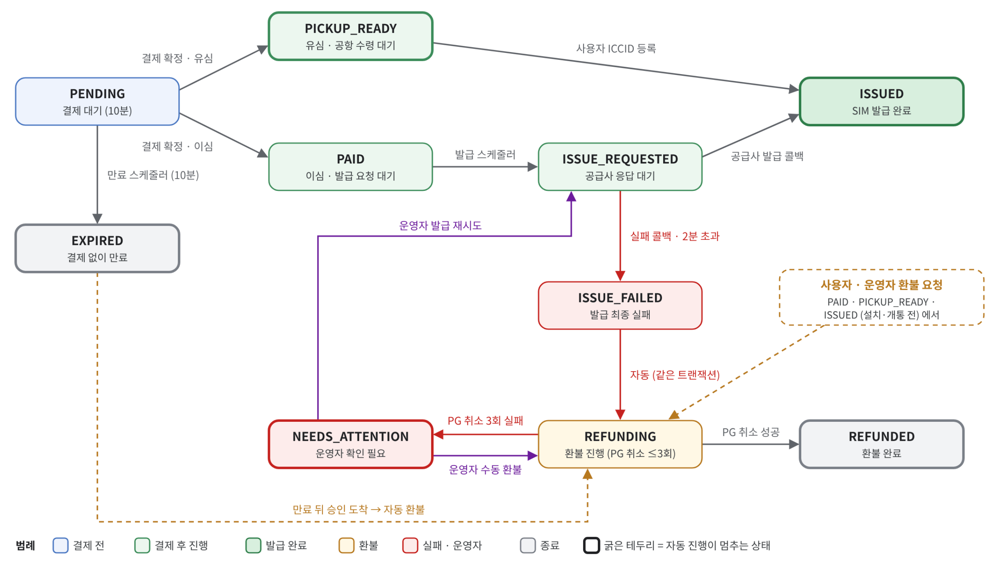
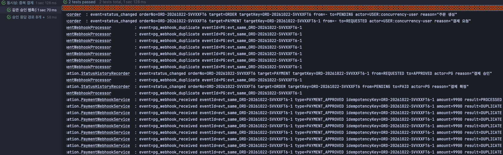
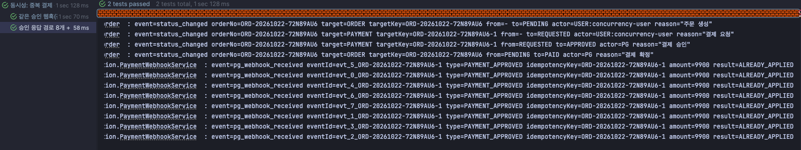
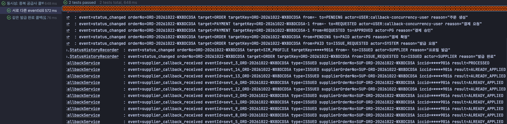
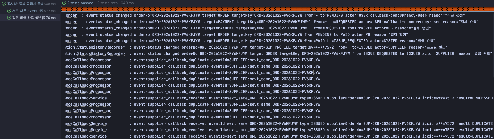
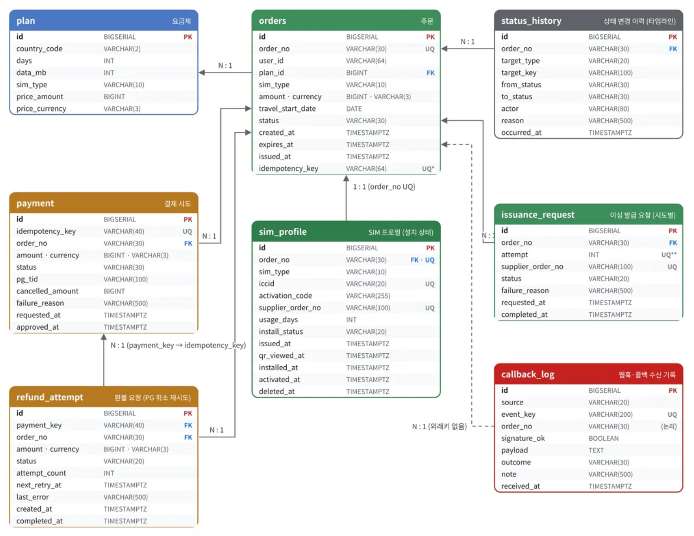
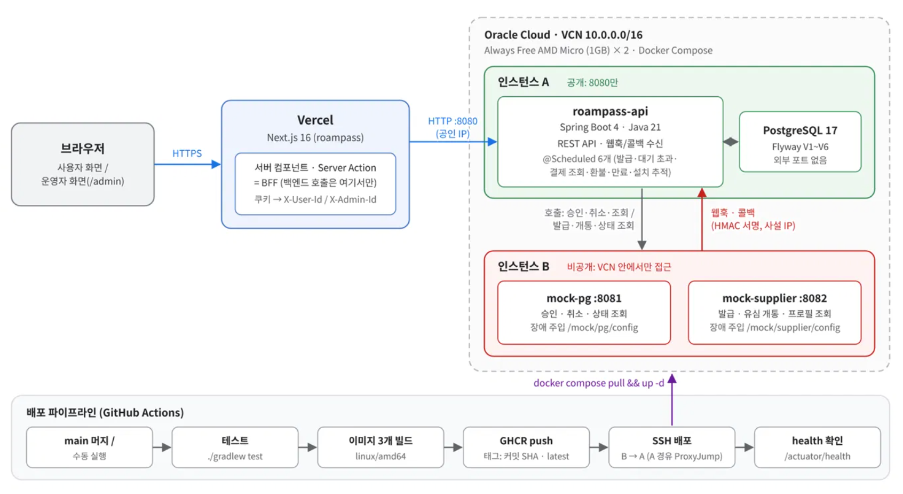

# ROAMPASS_SERVER

여행자용 유심(USIM)·이심(eSIM) 판매 서비스 **ROAMPASS**의 서버

---

## 1. 실행 방법

### 사전 요구사항
- Docker, Docker + Docker Compose v2
- JDK 21 (테스트 시)

### 로컬 실행

```bash
git clone https://github.com/Voyager003/ROAMPASS_SERVER.git
cd ROAMPASS_SERVER

cp .env.example .env

docker compose --profile app up -d --build
```

```
# 기동 확인
curl http://localhost:8080/actuator/health
curl http://localhost:8081/actuator/health
curl http://localhost:8082/actuator/health
```

### 테스트

```bash
// Docker 실행 후에
./gradlew test
```

### API 호출 시 식별 헤더
회원 시스템 대신 헤더로 호출자를 구분합니다(과제 2.2 허용 범위).
- 사용자 API(`/api/**`): `X-User-Id: user-1`
- 어드민 API(`/admin/**`): `X-Admin-Id: admin-1`

```bash
# 요금제 목록 (헤더 불필요, 조건은 모두 선택·정확히 일치)
curl 'localhost:8080/api/plans?country=JP&simType=ESIM'

# 주문 생성 → 201 + Location, 10분 안에 결제하지 않으면 EXPIRED
# Idempotency-Key(선택): 같은 키로 다시 보내면 새 주문 없이 처음 주문을 그대로 돌려줌
curl -i -X POST localhost:8080/api/orders -H 'X-User-Id: user-1' -H 'Idempotency-Key: 3f6c1a2e-7b7d-4c55-9f0e-1d2b3c4d5e6f' \
  -H 'Content-Type: application/json' -d '{"planId": 1, "travelStartDate": "2026-10-25"}'

# 주문 조회 (남의 주문은 404)
curl localhost:8080/api/orders/{orderNo} -H 'X-User-Id: user-1'

# 결제 (mock-pg가 떠 있어야 함) → paymentStatus·orderStatus
curl -X POST localhost:8080/api/orders/{orderNo}/pay -H 'X-User-Id: user-1'

# 내 SIM 목록 (결제된 주문만, 최신순, size 최대 50)
curl 'localhost:8080/api/sims?page=0&size=20' -H 'X-User-Id: user-1'

# 내 SIM 상세: 결제 금액·주문/설치 상태·ICCID·활성화 코드·만료 시각·남은 시간·환불 가능 여부·발급 대기 정보
curl localhost:8080/api/sims/{orderNo} -H 'X-User-Id: user-1'

# 사용자 환불 요청 → 202 REFUNDING (발급 전이거나 설치 전 SIM만, 아니면 409)
curl -X POST localhost:8080/api/orders/{orderNo}/refund -H 'X-User-Id: user-1'
```
- 응답 시각은 UTC ISO-8601(`...Z`)입니다. 에러는 RFC 9457 `ProblemDetail`에 `code`(예: `ORDER_NOT_FOUND`, `INVALID_REQUEST`)가 붙습니다.
- `travelStartDate`는 KST 기준 오늘부터 1년 이내여야 합니다.
- 브라우저에서 직접 호출할 때는 `roampass.cors.allowed-origins`(기본 `http://localhost:3000`, 환경변수 `CORS_ALLOWED_ORIGINS`)에 있는 주소만 허용합니다. 제출용 프론트(Next.js)는 서버 컴포넌트·Server Action에서만 이 API를 부르는 BFF 구조라 CORS를 거치지 않고, 이 설정은 브라우저나 다른 클라이언트가 직접 부를 때를 위한 것입니다.

---

## 2. Q&A

### 2.1 기술선택 이유

#### 2.1.1 ORM 및 쿼리: Spring Data JPA

선택 이유는 현재 회사에서 사용하는 기술 스택(with Mybatis)이기도 하고, 처음 써보는 기술을 어떻게 적용할 수 있을지에 대한 고민을 해볼 수 있을거라고 생각했습니다.

여기서 순수한 도메인 모델과 JPA 로직을 분리해서 작성했는데, 그 이유는 도메인은 핵심 비즈니스가 동작하기 때문에 변동이 많은 객체이기 때문입니다.

JPA를 미리 매핑해버리면 JPA 매핑과 DB 테이블이 고정되어서 추후에 추가적인 작업이 필요하다고 생각했으며, 때문에 도메인이 정립된 이후에 최종적으로 테이블에 매핑하는 용도로만 사용했습니다.       

처음 쓰는 기술이기 때문에 먼저 AI에게 공식 문서를 학습시킨 뒤에, 질답 형식으로 객체 간 테이블이 어떻게 매핑되는지, 작동 방식(프록시 구현체, 영속성 컨텍스트..)을 우선적으로 학습하고 이해한 부분에 대해서만 적용했습니다.

#### 2.1.2 비동기 작업: DB 상태 기반 `@Scheduled` 폴링

DB에 남은 상태를 스케줄러가 주기적으로 polling 하도록 처리했습니다.

익숙한 방식이기도 하고 복잡성을 크게 늘리지 않고 해결할 수 있는 방법이어서 택했습니다.

#### 2.1.3 DB: PostgreSQL 17 + Flyway

DB도 마찬가지로 회사에서 사용하는 기술이고, 익숙한 RDB여서 택했습니다.

#### 2.1.4 호스팅 및 배포: Oracle Cloud, Docker

Oracle을 선택한 이유는 1GB 인스턴스를 2개까지 무료로 사용할 수 있기 때문에 비용을 고려한 선택입니다.

프로덕션 상황이라면 각 애플리케이션, DB, 모의 PG/공급사까지 고려했을 때 4개 이상의 인스턴스를 구성해야 하겠지만 비용의 문제로 다음과 같이 구성했습니다.

- 인스턴스 1: App Server + DB(Postgres)
- 인스턴스 2: Mock PG, Mock SIM 공급사

이 때 각 서버는 Docker 컨테이너로 관리하며, Docker를 선택한 이유는 익숙한 기반의 기술이고 일관적인 배포 환경을 쉽게 구성할 수 있기 때문에 선택했습니다.

#### 추가한 라이브러리

테스트를 위해 **Testcontainers**를 도입을 했습니다. 

단위 테스트는 주로 도메인 기능이 제대로 작동하는지 확인하며, 별도의 통시성 테스트나 시나리오 테스트(ex: 결제가 되었지만 발급이 실패하면 자동으로 환불되어야 한다)를 테스트 해야했기 때문에 별도로 도입했습니다.

### 2.2 결제, 발급, 주문 상태 설계



#### 2.2.1 결제는 되었는데 발급이 안된 경우

ESIM 주문은 결제가 확정되면 `PAID`가 되고, 발급 스케줄러가 10초마다 이 주문을 찾아 공급사에 발급을 요청하면서 `ISSUE_REQUESTED`로 바꿉니다. 

공급사는 접수만 바로 응답하고 SIM 정보는 몇 초 뒤 콜백으로 보내므로, 정상이라면 이 두 상태는 수 초에서 십여 초 사이에 지나가고 주문은 `ISSUED`가 됩니다. 즉 "결제는 됐는데 아직 발급이 안 된" 주문은 평소에는 `PAID` 또는 `ISSUE_REQUESTED`에 잠깐 머무는 것이고, 문제는 이 상태에서 끝나지 않는 경우입니다.

발급이 실패하는 경우는 세 가지로, 1) 공급사가 실패 콜백을 보내거나 2) 발급 요청 자체를 거절하거나 3) 2분이 지나도록 콜백이 오지 않는 경우입니다. 

어느 경우든 주문은 `ISSUE_FAILED`가 되고, 같은 트랜잭션 안에서 곧바로 `REFUNDING`으로 넘어가며 환불 요청이 만들어집니다. 

실패와 환불 시작을 한 트랜잭션에 묶었기 때문에 "발급은 실패했는데 환불은 시작되지 않은" 상태는 생기지 않으며, 이후 환불 스케줄러가 15초마다 PG에 결제 취소를 요청하고, 성공하면 주문은 `REFUNDED`로 끝납니다.

PG 취소도 타임아웃이나 서버 문제로 실패할 수 있기 때문에, 1분 → 2분 간격으로 최대 3번까지 다시 시도하며, 같은 취소 키로 다시 보내므로 실제로는 취소가 됐는데 응답만 못 받은 경우에도 두 번 취소되지 않습니다. 

끝내 3번 모두 실패하면 더 이상 자동으로 재시도하지 않고 주문을 `NEEDS_ATTENTION`으로 옮겨 운영자에게 넘깁니다. 

운영자는 "처리 대기 → 환불 실패"에서 이 주문을 보고, 수동 환불(다시 `REFUNDING`)이나 발급 재시도(다시 `ISSUE_REQUESTED`) 중 하나를 선택하도록 설계했습니다. 

이는 모두 이력에 운영자 ID와 이유가 남고, 두 운영자가 동시에 눌러도 한 번만 실행됩니다.

자동 처리 중간에 서버가 멈추는 등의 이유로 결제 승인 후 5분이 지나도 `PAID`나 `ISSUE_REQUESTED`에 머무는 주문은 어드민 "처리 대기 → 결제 후 미발급"에 모입니다. 

결과적으로 결제된 주문은 발급 완료(`ISSUED`), 환불 완료(`REFUNDED`), 운영자 확인 대상(`NEEDS_ATTENTION`, 미발급 목록) 중 하나로 반드시 드러나며, 결제만 되고 아무도 모르는 채 남는 주문은 없도록 설계했습니다.

#### 2.2.2 사용자가 결제 직후 브라우저를 닫는다면?

결제 확정 이후는 발급은 서버가 끝까지 진행하는 구조라고 생각했습니다. 따라서 사용자가 결제 직후 브라우저를 닫아도 발급은 그대로 진행됩니다.

먼저 결제 자체는 브라우저가 아니라 서버에서 확정됩니다. 결제 버튼을 누르면 요청은 Next.js 서버를 거쳐 roampass-api로 가고, roampass-api가 PG에 승인을 요청합니다. 브라우저가 그 응답을 받지 못하더라도 PG가 보내는 웹훅으로 결제가 확정되고, 웹훅마저 오지 않으면 1분 뒤 결제 상태 조회 스케줄러가 PG에 직접 물어 확정합니다.

결제가 확정되어 주문이 `PAID`가 되면, 그 상태 자체가 "발급해야 함"이라는 표시로 DB에 남습니다. 

발급 스케줄러는 사용자 요청과 상관없이 10초마다 `PAID` 주문을 찾아 공급사에 요청하고, 결과도 공급사 콜백으로 서버에 직접 들어옵니다. 

발급이 실패했을 때의 대기 초과 판단과 자동 환불도 모두 서버 스케줄러가 처리하며, 서버가 재시작되더라도 작업은 DB에 그대로 남아 있으므로 이어서 폴링을 시도합니다.

### 2.3 중복 처리






테스트는 [중복 결제 통지](`roampass-api/src/test/java/com/roampass_server/e2e/IssuanceDuplicateCallbackConcurrencyTest.java`), [중복 공급사 콜백](`roampass-api/src/test/java/com/roampass_server/e2e/PaymentDuplicateNotificationConcurrencyTest.java`) 에서 진행합니다.

먼저 중복 처리는 **유니크 제약과 조건부 UPDATE**를 조합하여 처리했습니다.

같은 요청이 여러 번 오는 경우는 유니크 제약으로 방어하고, PG 웹훅과 공급사 콜백을 처리하기 전에, 발신 측이 준 이벤트 ID로 만든 key(`PG:{eventId}`, `SUPPLIER:{eventId}`)를 수신 기록 테이블에 먼저 넣습니다. 

이 key에는 UNIQUE 제약이 걸려있고 INSERT는 `ON CONFLICT DO NOTHING`으로 실행하기 때문에, 같은 통지가 동시에 여러 개 와도 처음 하나만 기록되고 나머지는 영향받는 row가 없기 때문에 "중복"으로 끝납니다.

key 같은 경우는 이벤트 ID로 정했는데 재전송된 본문이 조금 달라도 같은 이벤트로 보기 위해서입니다.

이벤트 ID는 다르지만 결과가 같은 경우는 조건부 UPDATE로 막습니다. 

예를 들어 **PG 승인 응답과 승인 웹훅은 서로 다른 경로로 같은 결제를 확정**하려 하고, 공급사가 같은 발급 결과를 다른 이벤트 ID로 다시 보낼 수도 있습니다. 

그래서 모든 상태 변경을 "예상한 이전 상태일 때만 바꾼다"는 조건(`WHERE status = 'REQUESTED'`)으로 실행하고, 영향 row로 성공 여부를 판정합니다.

**비관적 락** 조회 시점부터 commit까지 lock을 소유하기 때문에 중복 요청을 모두 대기하게 만들고 잠금 순서까지 관리해야 하는데, 현재 지켜야 할 조건은 "row 하나의 상태가 예상값일 때만 바꾼다"뿐이라 조건부 UPDATE 한 문장으로 같은 보장을 얻을 수 있어 택하지 않았습니다.

**낙관적 락** 자주 일어날 수 있는 중복 통지를 매번 예외로 알리고 업무와 무관한 변경에도 충돌이 나기때문에, Version 기반 필드 대신 업무 상태를 비교해 중복을 영향 행 0으로 받는 조건부 UPDATE를 택했습니다. 

### 2.4 트랜잭션 경계

PG 호출과 공급사 호출은 모두 DB 트랜잭션 밖에 위치합니다.

결제를 예로 들면, 먼저 한 트랜잭션에서 결제 시도를 `REQUESTED`로 저장하고 커밋한 뒤(`PaymentRequestService.start`), 트랜잭션 밖에서 PG에 승인을 요청하고(`PaymentService.pay`), 응답을 받으면 별도 트랜잭션에서 결과를 반영합니다(`PaymentConfirmationService`). 발급도 같은 구조로, 주문을 `ISSUE_REQUESTED`로 바꾸고 발급 요청을 저장하는 트랜잭션, 공급사 호출, 접수 결과를 반영하는 트랜잭션이 나뉘어 있습니다. 환불(PG 취소)과 공급사 상태 조회도 마찬가지입니다.

외부 호출을 트랜잭션 안에 두면 상대가 응답하는 동안(최대 5초) DB 연결과 행 잠금을 계속 쥐고 있게 되어, 같은 주문에 들어온 웹훅·콜백·환불 요청이 그동안 기다려야 합니다. 또 트랜잭션은 롤백할 수 있어도 이미 보낸 외부 호출은 되돌릴 수 없어서, PG는 승인했는데 우리 쪽만 롤백되어 결제 기록이 사라지는 상황이 생길 수 있습니다. 그래서 "보낼 일을 먼저 DB에 기록하고 커밋 → 외부 호출 → 결과를 따로 반영" 순서로 정했고, 중간에 끊기더라도 DB에 남은 상태와 멱등 키로 이어서 처리합니다.

#### 2.4.1 공급사가 접수했는데 우리 DB 저장이 실패하는 경우

공급사 호출 전에 발급 요청이 `PENDING`으로 이미 커밋되어 있기 때문에, 공급사가 접수한 뒤 우리 쪽 저장(접수 번호 기록)이 실패해도 요청 자체가 사라지지는 않습니다. 

발급 요청은 `PENDING`으로 남고, 10초 주기로 발급 스케줄러가 polling하여 **같은 멱등 키**(`{주문번호}-ISSUE-{시도}`)로 다시 보냅니다. 

공급사는 같은 키를 이미 받은 접수로 보고 같은 접수 번호를 돌려주므로 SIM이 두 번 발급되지 않고, 이번에는 우리 쪽 저장이 성공합니다.

그 사이 공급사의 발급 완료 콜백이 먼저 도착할 수도 있는데, 콜백에는 서버의 주문번호가 있어 접수 번호가 아직 저장되지 않더라도 주문을 찾아 처리하고, 나중에 도착한 접수 응답은 이미 끝난 요청을 바꾸지 않습니다. 

콜백 처리 자체가 DB 오류로 실패하면 수신 기록까지 함께 롤백되어 같은 콜백이 다시 오면 새로 처리되며, 끝내 반영되지 못하면 2분 대기 초과 검사가 발급 실패로 처리해 자동 환불을 시작합니다. 

#### 2.4.3 결제 버튼 연타와 타임아웃 후 재시도

먼저 1차적인 방어는 클라이언트에서 버튼을 비활성화 시킵니다.

이 후 서버에서는 주문당 결제 시도 키(`{주문번호}-{시도 번호}`)로 막게 되는데, 결제를 요청하면 먼저 같은 주문에 아직 결과가 나지 않은(`REQUESTED`) 결제가 있는지 보고, 있으면 409 `PAYMENT_IN_PROGRESS`로 거절합니다. 

두 요청이 거의 동시에 들어오더라도 둘 다 같은 시도 번호로 같은 키를 만들고 `payment.idempotency_key`에 UNIQUE 제약이 있어 하나만 저장되고 나머지는 409로 충돌 예외를 발생시킵니다. 

Mock PG 측에도 이 키를 멱등 키로 보내므로 PG 쪽에서도 같은 결제가 두 번 승인되지 않습니다. 

**PG 승인 타임아웃 후 재시도**같은 경우 새 결제를 만들지 않고 같은 결제 시도 키로 결과를 확인합니다. 응답을 받지 못하면 결제는 `REQUESTED`로 남고, 이 상태에서 사용자가 다시 결제를 눌러도 `PAYMENT_IN_PROGRESS`로 막아 새 승인 요청을 보내지 않습니다. 

대신 PG 웹훅이 오면 그것으로 확정하고, 1분이 지나도 확정되지 않으면 상태 조회 스케줄러가 같은 키로 PG에 결과를 물어 확정합니다. PG에 요청이 닿지 않았던 것으로 확인되면 실패로 닫아 다시 결제할 수 있게 합니다.

**공급사 발급 타임아웃 후 재시도**는 앞에서 설명한 발급 요청 키(`{주문번호}-ISSUE-{시도}`)를 그대로 다시 보내고, **PG 취소 타임아웃 후 재시도**는 환불 요청마다 고정된 취소 키(`refund-{환불 요청 id}`)를 다시 보냅니다. 

실제로는 처리됐는데 응답만 못 받은 경우에도 상대가 같은 키를 한 번만 반영하여 중복이 발생하지 않도록 설계했습니다.

### 2.5 사용자 SIM 설치 판단

설치와 개통은 공급사가 알려 주는 결과를 근거로 합니다. 

현재 애플리케이션 서버가 직접 아는 것은 사용자가 설치 코드를 연 사실(`QR_VIEWED`)뿐인데, 이것은 "코드를 봤다"는 뜻일 뿐 기기에 설치했다는 증거가 아니므로 환불 가능 여부에 영향을 주지 않습니다. 

공급사 결과는 크게 두 가지로:

**개통 이벤트 콜백**은 개통되는 즉시 오지만 가끔 누락되고, **상태 조회 API**는 현재 우리 서버 측에서 요청해야 알 수 있지만 언제든 다시 물을 수 있습니다. 

콜백은 서명이 맞을 때만 신뢰하고 같은 이벤트 ID는 한 번만 반영하며, 상태 조회의 `INSTALLED`는 설치, `ENABLED`는 개통의 근거로 씁니다. 

개통 시각은 공급사가 알려 준 UTC 값을 그대로 저장하고, 만료일은 이 시각에 24시간 × 사용 일수를 더해 계산합니다(표시는 KST). 

공급사가 `DELETED`를 알려 주면 상태는 그대로 두고 삭제 시각만 기록하므로, 설치했다가 지운 SIM도 환불할 수 없습니다.

**콜백이 빠지거나 늦는 경우** 상태 조회를 안전망으로 두었습니다. 개통 콜백이 오면 바로 `ACTIVE`로 반영하고, 콜백이 빠지면 다음 상태 조회(최대 약 1분 뒤)가 `ENABLED`를 보고 같은 결과로 반영합니다. 

설치(`INSTALLED`)는 콜백이 없어 상태 조회로만 알 수 있습니다. 두 경로는 같은 코드(`ProfileSignalApplier`)로 반영되고, 설치 상태는 앞으로만 진행하며 조건부 UPDATE로 저장합니다.

그래서 늦게 온 이전 단계 신호나 중복 신호는 무시되고, 콜백과 상태 조회가 같은 개통을 동시에 반영해도 상태는 한 번만 바뀌고 이력도 1건만 남습니다(`e2e/ActivationSignalConcurrencyTest`). 

설치 신호 없이 개통 신호가 먼저 오면 개통은 설치를 포함한 것으로 보고 비어 있는 설치 시각을 채웁니다.

**상태 조회**는 1분 주기로 아직 개통되지 않았고(`ISSUED`·`QR_VIEWED`·`INSTALLED`) 기기에서 삭제되지 않았으며, 여행 시작일 3일 전부터 여행 시작일 + 사용 일수까지의 기간 안에 있는 SIM만 조회합니다. 

여행이 아직 먼 SIM은 설치할 가능성이 낮고, 이미 개통된 SIM은 만료가 시간만으로 정해져 조회할 때 계산하면 되므로 다시 묻지 않도록 설계했습니다. 

운영자는 어드민 주문 상세의 타임라인에서 상태가 언제, 어떤 신호로 바뀌었는지(주체 `SUPPLIER`, 사유 "공급사 개통 콜백" 또는 "공급사 상태 조회: ENABLED")와 프로필의 설치·개통·삭제 시각을 그대로 봅니다. 

그래서 공급사가 잘못된 신호를 보냈다면 어느 경로로 들어온 것인지 확인할 수 있습니다. 다만 공급사가 잘못 `ENABLED`를 보내 환불이 `SIM_NOT_REFUNDABLE`로 막힌 경우, 운영자가 이를 덮어쓰고 환불하는 기능은 만들지 않았습니다. 

사용자는 내 SIM 화면에서 설치 상태와 환불 가능 여부를 봅니다. 화면에 "설치 전"으로 보여도 환불을 요청하면 서버가 공급사를 다시 조회하므로, 실제로 설치됐다면 "설치하거나 개통한 SIM은 환불할 수 없어요"라는 안내와 함께 거절되고 화면의 설치 상태도 함께 갱신됩니다.

### 2.6 어드민과 사용자 화면에서 서버와 클라이언트의 경계

먼저 판단은 전부 서버가 하고 클라이언트는 서버가 준 결과를 보여주도록 결정했습니다. 이는 상태를 검증하는 작업은 클라이언트를 신뢰하면 안된다고 판단했기때문입니다.

주문·결제·설치 상태, 환불 가능 여부, 남은 사용 시간과 만료 시각, 운영자 조치를 실행할 수 있는지는 모두 서버가 요청 시점 기준으로 판정해 응답에 담습니다. 

**발급 대기 화면** 같은 경우 클라이언트 polling으로 받습니다. 결제 후 화면은 주문이 서버에서 움직이는 동안(`PAID`, `ISSUE_REQUESTED`, `ISSUE_FAILED`)만 백엔드가 응답에 담아 준 간격마다 화면을 서버에서 다시 그립니다. 

주문이 `ISSUED`나 `REFUNDING`·`REFUNDED`되면 polling을 멈춥니다.

polling을 고른 이유는 발급을 서버 스케줄러가 끝까지 진행하므로 화면이 연결을 붙잡고 있을 이유가 없기 때문입니다. 브라우저를 닫았다 다시 열어도 같은 조회 한 번이면 현재 상태를 알 수 있고, 결과는 길어야 2분 남짓(콜백 대기 한도) 안에 나오므로 3초 간격 조회 비용도 작습니다. 

SSE같은 경우 생소한 개념이기도 하고 연결 관리와 재연결 시 놓친 이벤트 처리가 추가로 필요해 택하지 않았습니다.

**어드민이 보는 결제 상태**에서 어드민 응답은 모두 `{asOf, data}` 형태이고, `asOf`는 서버가 DB를 조회한 시각입니다. 

어드민 화면은 이 값을 기준으로 "N초 전 데이터"를 매초 갱신해 보여 주고, 시각에 마우스를 올리면 KST 조회 시각이 나오며, 옆의 새로고침 버튼으로 필터를 유지한 채 다시 조회합니다. 

다만 DB에 저장된 결제·설치 상태 자체도 외부 신호가 반영된 시점의 값이라, 결제는 웹훅(보통 즉시)이나 상태 조회(최대 약 1분 30초), 설치는 상태 조회 주기(최대 약 1분)만큼 실제보다 늦을 수 있습니다. 

그래서 환불처럼 결과가 갈리는 조치는 화면의 값을 믿지 않고 실행 직전에 공급사 상태를 다시 조회해 판정합니다.

### 2.7 과제에서 처음 써본 것

서버에서 처음 도입해본 기술은 **JPA**입니다.

도입을 위해 AI에 공식 문서를 학습 시킨 뒤에 핵심 문법, 영속성 컨텍스트(flush), 객체를 매핑했을 때 실제 DB 테이블에 어떻게 반영되는지 작동 메커니즘을 짧게 숙지했습니다. 

실제로 한정된 시간에 프로덕션에 즉시 적용해야 한다는 상황을 가정을 했기 때문에, 이해한 내용을 기반으로 프로젝트에 적용하고 제가 이해한 선까지만 사용(매핑, 단순 조회)하고, JPA가 제공하는 장점을 전부 사용하진 않았습니다.

의도한대로 작동하는지에 대한 결과는 테스트 코드로 검증을 했습니다.

### 2.8 시간이 더 있었다면?

서버에서 발생할 수 있는 엣지 케이스를 고려하여 예외 처리를 추가 했을 것입니다.

프로덕션 서버를 운영한다고 가정하면 오류를 조기에 파악할 수 있는 로깅/메트릭 서버를 구성하고, 사용자 경험을 위해 우선적으로 필요한 다국어/다통화 기능을 우선하고, 데이터 사용량 알림, 장기 미설치 알림 기능을 추가로 구현하는 것이 좋은 방향이라고 생각합니다.  

---

## 3. 시연 방법

### 준비

1. [로컬 실행](#로컬-실행)으로 백엔드 4개를 띄우고, 프론트(`roampass`)를 `npm run dev`로 띄워 `http://localhost:3000`에서 진행합니다. 
2. 화면 없이 API로만 확인해도 됩니다.
2. 장애는 모의 서버의 설정 API로 켭니다. (시나리오가 끝나면 초기화합니다.)

```bash
PG=localhost:8081/mock/pg/config            # 모의 PG
SUP=localhost:8082/mock/supplier/config     # 모의 공급사
J='Content-Type: application/json'

curl $PG; curl $SUP                                   # 현재 설정 보기
curl -X POST $PG/reset; curl -X POST $SUP/reset       # 초기화(장애 없음)
```

배포 환경에서은 모의 서버(인스턴스 B)를 외부에 공개하지 않아 장애 주입 API에 접근할 수 없습니다. 장애 시나리오는 로컬에서 확인하고, 배포 환경에서는 정상 흐름과 설치·개통 시연 버튼(C-1, D-1)을 확인할 수 있습니다.

### A. 결제 (모의 PG)

| # | 시나리오 | 설정 | 확인할 것 |
|---|---|---|---|
| A-1 | 승인 실패 | `curl -X PUT $PG -H "$J" -d '{"approveFailureRate":1}'` | 결제가 실패로 끝나고 주문은 결제 대기로 남음. 설정을 끄면 같은 주문으로 다시 결제 가능 |
| A-2 | 응답 유실 (타임아웃 + 웹훅 누락) | `curl -X PUT $PG -H "$J" -d '{"responseDelayMs":6000,"webhookDrop":true}'` | 약 5초 뒤 "결제 확인 중"이 보이고, 약 1분~1분 30초 뒤 상태 조회 스케줄러가 PG에 물어 결제 확정 → 발급 진행. 어드민 타임라인의 결제 승인 주체는 시스템 |
| A-3 | 중복 웹훅 | `curl -X PUT $PG -H "$J" -d '{"webhookDuplicates":3}'` | 결제는 한 번만 승인됨. 어드민 상세의 콜백 기록에 같은 eventId가 `DUPLICATE`로 남음 |
| A-4 | 웹훅 금액 변조 | `curl -X PUT $PG -H "$J" -d '{"webhookAmountDelta":100,"responseDelayMs":6000}'` | 금액이 다른 웹훅은 거절되어 어드민 "처리 대기 → 결제 금액 불일치"에 남음. 약 1분~1분 30초 뒤 PG에 저장된 맞는 금액으로 확정 |

설정 항목: `approveFailureRate`(0~1), `responseDelayMs`(0~60000, 결제는 먼저 기록하고 응답만 늦춤), `webhookDuplicates`(0~10, 같은 eventId 추가 발송), `webhookDrop`, `webhookAmountDelta`(웹훅 금액만 변경), `cancelFailureRate`(0~1, 취소 시 500).

### B. 발급·환불 (모의 공급사)

공급사는 접수만 바로 응답하고, 결과는 약 3초 뒤 서명된 콜백으로 보냅니다.

| # | 시나리오 | 설정 | 확인할 것 |
|---|---|---|---|
| B-1 | 발급 실패 → 자동 환불 | `curl -X PUT $SUP -H "$J" -d '{"issueFailureRate":1}'` | 결제 후 수 초 안에 발급 실패 → 자동 환불 → 환불 완료 |
| B-2 | 중복 콜백 | `curl -X PUT $SUP -H "$J" -d '{"callbackDuplicates":3}'` | SIM은 한 번만 발급됨. 어드민 콜백 기록에 `DUPLICATE` |
| B-3 | 콜백 누락 | `curl -X PUT $SUP -H "$J" -d '{"callbackDrop":true}'` | 발급 요청 후 2분(+ 검사 주기 최대 30초)이 지나면 "발급 콜백 대기 시간 초과"로 실패 → 자동 환불 |
| B-4 | 서명 오류 | `curl -X PUT $SUP -H "$J" -d '{"invalidSignature":true}'` | 콜백이 401로 거절되어 "처리 대기 → 서명 불일치"에 남고, B-3처럼 2분 뒤 실패 → 자동 환불 |
| B-5 | 환불까지 실패 → 운영자 확인 | `curl -X PUT $SUP -H "$J" -d '{"issueFailureRate":1}'`<br>`curl -X PUT $PG -H "$J" -d '{"cancelFailureRate":1}'` | PG 취소가 1분 → 2분 간격으로 3번 실패(약 3분)한 뒤 `NEEDS_ATTENTION`. 어드민 "처리 대기 → 환불 실패"에 나타남 → E에서 조치 |

설정 항목: `issueFailureRate`(0~1), `callbackDelayMs`(0~60000, 기본 3초에 더함), `callbackDuplicates`(0~10), `callbackDrop`(발급·개통 콜백 모두), `invalidSignature`, `activationCallbackDrop`(개통 콜백만 누락).

### C. 이심 설치·개통

| # | 시나리오 | 방법 | 확인할 것 |
|---|---|---|---|
| C-1 | 설치·개통 (화면) | 이심 발급 후 내 SIM 상세 → **기기에 설치하기** → **현지에서 개통하기** | 설치 상태가 설치됨 → 개통됨으로 바뀌고, 개통 시각·남은 기간·만료(KST)가 보임. 환불 칸은 "환불할 수 없어요" |
| C-2 | 개통 콜백 누락을 폴링이 메움 | 아래 명령 | 약 1분 안에 개통됨으로 바뀌고, 어드민 타임라인 사유가 "공급사 상태 조회: ENABLED" |

C-1의 버튼은 모의 공급사의 상태를 바꾸고 그 응답을 바로 반영하는 시연 API(`POST /api/sims/{orderNo}/demo/install`, `/demo/activate`)를 부릅니다. C-2는 공급사 상태만 직접 바꿔 폴링 경로를 보여 줍니다. 폴링은 **여행 시작일이 오늘부터 3일 안**이고 아직 개통 전인 SIM만 조회하므로, 시작일을 그렇게 골라 주문합니다.

```bash
curl -X PUT $SUP -H "$J" -d '{"activationCallbackDrop":true}'      # 개통 콜백만 끔
# ICCID는 내 SIM 상세 또는 어드민 상세에서 확인
curl -X POST localhost:8082/mock/supplier/profiles/{iccid}/state -H "$J" -d '{"state":"ENABLED"}'
```

### D. 유심 등록

| # | 시나리오 | 방법 | 확인할 것 |
|---|---|---|---|
| D-1 | 공항 수령 → 등록 (화면) | 유심 결제 후 내 SIM 상세 → **공항에서 유심 받기** → 번호가 채워지면 **ICCID 등록** | 발급 완료, 공급사가 바로 개통해 개통됨 |
| D-2 | 잘못된 번호 | D-1에서 받은 번호의 마지막 자리를 바꿔 등록 | 체크 디지트 오류로 등록 버튼이 막히고, API로 보내면 400 `INVALID_ICCID` |
| D-3 | 이미 쓴 번호 | 다른 유심 주문에 D-1에서 등록한 번호를 입력 | 409 `ICCID_ALREADY_REGISTERED` |

"공항에서 유심 받기"는 실물 카드 대신 모의 공급사가 이 주문에 내준 번호를 받아 오는 시연 API(`POST /api/orders/{orderNo}/demo/pickup-card`)이고, 등록은 일반 API(`POST /api/orders/{orderNo}/usim/register`)를 그대로 탑니다.

### E. 운영자

화면은 `http://localhost:3000/admin`(주문 목록·상세, 처리 대기)입니다.

| # | 시나리오 | 방법 | 확인할 것 |
|---|---|---|---|
| E-1 | 이상 건 모아 보기 | "처리 대기" 메뉴 | 결제 후 5분 넘게 미발급, 환불 실패, 결제 금액 불일치, 서명 불일치 |
| E-2 | 수동 환불 | B-5 주문에서 PG 장애를 끄고(`curl -X POST $PG/reset`) 상세 → 수동 환불(사유 입력) | 환불 완료. 타임라인에 운영자 ID와 사유 |
| E-3 | 발급 재시도 | B-5로 만든 다른 주문에서 공급사 장애를 끄고(`curl -X POST $SUP/reset`) 상세 → 발급 재시도(사유 입력) | 다음 시도 번호로 다시 발급 → 발급 완료 |
| E-4 | 동시 조치 | 두 브라우저에서 같은 주문의 조치를 동시에 누름 | 한쪽만 성공하고 다른 쪽은 409로 거절("다른 조치나 시스템 처리가 먼저 반영됐어요"). 조치 이력도 1건 |

API로 확인하려면 다음을 씁니다.

```bash
curl localhost:8080/admin/issues -H 'X-Admin-Id: admin-1'
curl localhost:8080/admin/orders/{orderNo} -H 'X-Admin-Id: admin-1'
curl -X POST localhost:8080/admin/orders/{orderNo}/refund  -H 'X-Admin-Id: admin-1' -H "$J" -d '{"reason":"자동 환불 실패 건 수동 처리"}'
curl -X POST localhost:8080/admin/orders/{orderNo}/reissue -H 'X-Admin-Id: admin-1' -H "$J" -d '{"reason":"공급사 복구 후 재발급"}'
```

---

## 4. 데이터 모델, 아키텍처




---

## 5. 미구현

- **PG에서 다른 금액으로 승인된 결제**: 확정하지 않고 `REQUESTED`로 남깁니다. 웹훅으로 온 경우는 어드민 이상 건("금액 불일치 통지")에 나오지만, 승인 응답·상태 조회 경로에서 발견한 경우는 ERROR 로그만 남고 이상 건 목록에는 나오지 않습니다. 그동안 그 주문은 새 결제도 막힙니다.
- **웹훅 동기 처리**: 받은 요청 안에서 처리합니다. 처리량이 커지면 수신 기록만 남기고 큐로 넘기는 구조가 맞지만, 이 규모에서는 단순한 쪽을 택했습니다.
- **mock-pg 웹훅 재시도 없음**: 실제 PG처럼 실패 시 재전송하지는 않습니다. 중복 수신은 장애 주입의 `webhookDuplicates`로 재현합니다.
- **공급사 쪽 프로필 회수 없음**: 실패 처리 뒤 늦게 성공 콜백이 오거나, 발급된(미설치) SIM을 수동 환불해도 공급사에 프로필 회수를 요청하지 않습니다(부록 A 계약에 회수 API가 없음).
- **개통 후 삭제는 추적하지 않음**: 폴링 대상이 개통 전 SIM뿐이라, 개통한 뒤 기기에서 지운 것은 반영되지 않습니다. 설치·개통 여부와 환불 불가 판정은 개통 시점에 이미 정해져 결과가 달라지지 않습니다.
- **공급사 신호 정정 기능 없음**: 공급사가 잘못된 상태를 줘도 설치 상태는 앞으로만 진행해서, 운영자가 되돌리거나 덮어쓸 수 없습니다.
- **어드민 목록**: 검색 SQL로 주문번호를 고른 뒤 행마다 주문·결제·프로필을 추가 조회합니다(N+1, 페이지 최대 50건). 결제 상태 필터는 "가장 최근 결제 시도" 기준이라 서브쿼리가 주문마다 돌고, `payment(order_no)` 일반 인덱스는 따로 두지 않았습니다(데이터가 많아지면 추가 대상).
- **수동 환불은 전액만**: 부분 취소는 도메인·mock-pg에 있지만 운영자 API로는 열지 않았습니다. 사용자 환불 요청도 전액이며 사유는 받지 않습니다.
- **내 SIM 목록**: 어드민 목록과 같이 주문 행마다 프로필을 추가 조회합니다(N+1, 페이지 최대 50건).
- **사용자 환불 연타의 두 번째 요청은 409**: 같은 요청을 다시 보내도 200으로 돌려주는 멱등 처리는 하지 않았습니다. 화면은 409를 받으면 상세를 다시 조회해 `REFUNDING`을 보여 주면 됩니다.
- **mock-supplier "순서 뒤바뀜" 장애 주입 없음**: 콜백은 주문당 발급 결과 1건과 개통 1건뿐이고, 개통은 발급 뒤에만 일어나 둘의 순서가 바뀔 일이 없습니다. 실제로 생길 수 있는 순서 문제인 "접수 응답보다 발급 콜백이 먼저"(`IssuanceCallbackServiceTest`)와 "개통 콜백과 폴링 중 무엇이 먼저 오든 같은 결과"(`ActivationCallbackTest`, `ActivationSignalConcurrencyTest`)는 테스트로 검증했습니다. 설치·삭제 이벤트 콜백은 과제 문구(개통 이벤트 콜백)에 맞춰 만들지 않았습니다.
- **PG 웹훅 서명 검증은 과제 요구 밖**: 과제는 공급사 콜백의 서명 검증만 요구합니다. 위조 통지로 결제가 확정되는 것을 막기 위해 PG 웹훅에도 HMAC-SHA256 서명을 적용했습니다.

## 6. 투입 시간


